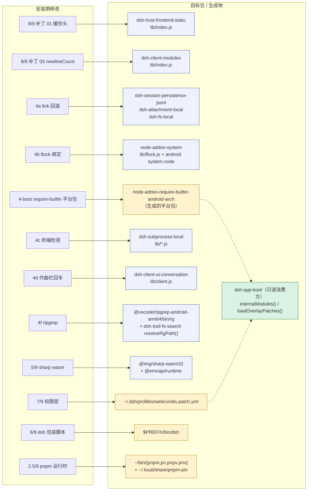
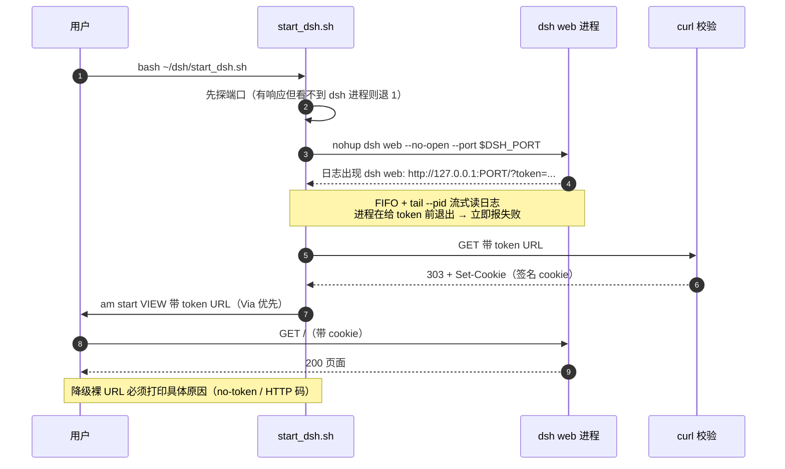

# REPORTS.md — deepseek-harness Android/Termux 修改与适配报告

> 本文件审计「deepseek-harness-android 对上游 `@deepseek-ai/dsh` 做的全部安装期修改」，并记录版本基准、rc.3 适配改动、验证证据与升级风险。
> 面向两类读者：**使用者**（升级前该知道什么）与**维护者**（改哪里、失败会怎样、怎么验证）。
> 使用说明见 `README.md`；维护契约与踩坑清单见 `AGENTS.md`；静态说明页见 `docs/index.html`。
>
> **文档状态**：v1.3（2026-11-17，清理版）。§2 修改全景与四张图完成；§3 rc.1→rc.3 适配已按 T1/T2 确认结论补全；§4 记录隔离验证。**v1.3 清理**：删除补丁 02 与弃用围栏、link 的 ≤0.2.1 旧形状、require-builtin 的 <0.1.7 分支、rg 的三种 rc.1 前旧形状及其夹具用例；安装期修改由 22 项降为 21 项，夹具断言 334→317。真实设备仍为 0.2.2-rc.1、3080 未重启（边界见 §4.3）。
> **事实来源**：仓库脚本与夹具的逐行审计 + 本机只读核对 + 团队 T1/T2/T3 报告。凡是推断或尚未验证的内容都显式标注「待确认」，不把未验证结论写成事实。

## 目录

- [0. 一页速览](#0-一页速览)
- [1. 版本基准与数据来源](#1-版本基准与数据来源)
- [2. 修改全景（核心）](#2-修改全景核心)
  - [2.1 修改总表](#21-修改总表)
  - [2.2 逐项详解](#22-逐项详解)
  - [2.3 图 1 setup.sh 九步流水线与补丁落点](#23-图-1-setupsh-九步流水线与补丁落点)
  - [2.4 图 2 修改项到 dsh 包文件映射](#24-图-2-修改项到-dsh-包文件映射)
  - [2.5 图 3 Web 鉴权与启动链路](#25-图-3-web-鉴权与启动链路)
  - [2.6 图 4 失效影响与漂移敏感度矩阵](#26-图-4-失效影响与漂移敏感度矩阵)
  - [2.7 幂等失败语义与历史遗留改动](#27-幂等失败语义与历史遗留改动)
- [3. rc.1 到 rc.3 适配改动](#3-rc1-到-rc3-适配改动)
- [4. 验证证据](#4-验证证据)
- [5. 风险与升级须知](#5-风险与升级须知)
- [6. 附录复现命令环境变量术语](#6-附录复现命令环境变量术语)

---

## 0. 一页速览

`@deepseek-harness-android` 不是上游的 fork，而是**安装与兼容性修补工具包**：它用 `npm install -g` 装官方 `@deepseek-ai/dsh`，然后对**已安装的那棵树**做幂等的安装期修补，让 dsh 在 Android/Termux 上能启动、能编辑文件、能发消息、能搜索、能刷新页面。仓库里只有胶水脚本与补丁；绝大多数改动落在安装树和用户 profile 里。

### 0.1 版本事实（2026-11-17 本机核对）

| 维度 | 当前值 | 核对方式 |
|---|---|---|
| GitHub 源码 | `git clone --depth 50 https://github.com/deepseek-ai/deepseek-harness.git` 后核对（本次的本地副本已清理）；最新 release tag `dsh-v0.2.2-rc.3` | `git describe --tags` |
| rc.3 tag 指向 commit | `38a6a5c965aa99ab525161efb7cc5cf1fe62fced` | `git rev-list -n1 dsh-v0.2.2-rc.3` |
| master HEAD | `39163dd30f703a79079e2d2446545cff3c453738`，比 rc.3 tag **多 565 个 commit** | `git rev-parse HEAD`；`package.json` 版本仍是 `0.2.2-rc.3` |
| npm dist-tags | `latest=0.2.2-rc.1`、`next=0.2.2-rc.3`、`alpha=0.2.2-alpha.3` | `npm view @deepseek-ai/dsh dist-tags --json` |
| 本机真实安装 | `0.2.2-rc.1`（npm 全局布局真实目录） | `node -p "require('<dsh>/package.json').version"` |
| 3080 上的 live 服务 | 跑在 0.2.2-rc.1 上的 `dsh web` 进程，**本次工作未重装、未重启、未杀** | `pgrep -af 'lib/[b]in.js web'` |
| 本机运行环境 | Node `v26.13.0` / npm `12.2.1` / pnpm `11.27.1`（`~/bin` 包装）/ ripgrep `15.2.0` | `node -v` 等只读命令 |
| rc.3 隔离验证（清理后复验） | **rc=0 / 2 分 25 秒 / 9 步全绿**；Web：token URL→303→cookie→`/` 200、`/assets` immutable、日志零 warn/error；运行期：node-pty / require-builtin（napi-v9）/ flock / rg 15.2.0 / sharp PNG / link / 4c / 4d / 权限层全通过；夹具 **8 个 / 317 断言 + 静态契约 42 条**（`verify-all-checks.sh` PASS=10，`--full` PASS=11） | 本轮隔离前缀 `~/work/verify-rc3`（临时 HOME + `--port 3098`） |

### 0.2 三条必须先记住的结论

1. **要区分「GitHub 最新」与「npm latest」**：GitHub 的 release tag 是 rc.3，`master` 还比它多 565 个 commit；但 npm 的 `latest` 仍是 **rc.1**，rc.3 在 `next` 上。`setup.sh` 默认 `npm install -g @deepseek-ai/dsh`（不带版本号），所以**默认装到的是 rc.1**；要装 rc.3 必须显式 `DSH_VERSION=0.2.2-rc.3 bash setup.sh`。
2. **升级 dsh 的唯一支持路径是重跑 `bash setup.sh`**。裸 `npm -g update` 会绕过 Android 编译参数与安装后补丁，把整棵安装树换回未修补的上游版本（并与 `$PREFIX/bin/dsh` 包装脚本冲突）。
3. **静态锚点全绿 ≠ 能用**：dsh 的历史故障里，「所有补丁自检通过、但 dsh 完全起不来」至少出现过两次（0.1.7 的 require-builtin 平台包缺失、权限层 `[]` YAML 追加）。所以验收顺序永远是「先真启动一次 + 走完鉴权链路」，再看夹具。
4. **rc.3 的安装树明显变大**：**1.2 GB / 93,932 文件**（rc.1 为 722 MB / 69,398 文件），主因是 `@deepseek-ai/libreoffice-kit-wasm@0.2.3` 取消了 `os:["linux"]` 限制（Android 上开始安装，约 **146 MB**）。升级前先看 Termux 剩余存储，并预留旧树 + 新树并存的临时空间。

### 0.3 修改规模速览

安装期修改共 **21 项**（§2.1 总表），按职责分 6 类；另有一批**保护性机制**（锚点预检、白名单自检、原子替换、夹具套件）不算对上游的修改，单列在 §2.7。

| 类别 | 项数 | 作用 | 失败语义概貌 |
|---|---|---|---|
| A 启动硬前提 | 3 | 缺任何一项 dsh 都**完全起不来** | 安装期 `error + exit 1` |
| B Android 兼容 | 6 | 启动后功能可用（文件/附件/消息/终端/搜索/图片） | 多数 `warn` 继续；`node-pty` / `sharp` / rg 解析失败属硬中断 |
| C 性能 | 3 | 前端缓存、客户端 bundle、行数统计 | 可选增强，失败只 `warn` |
| D 交互 UX | 1 | 作曲栏「回车=换行、Ctrl/Cmd+Enter=发送」 | 锚点异常 → 回滚 + 中断安装 |
| E 权限与配置 | 1 | `danger-full-access` 权限层（两条成对） | 缺失则权限预设不激活（bash 工具受限） |
| F 安装与运行期供给 | 8 | 让 npm / Node / pnpm / 脚本在 Termux 可用 | 视项而定：npm 包装/pnpm 供给失败为硬中断 |

**rc.3 适配状态（2026-11-17）**：21 项修改中 **19 项无需改锚点**（隔离实测命中），仅 **4d 作曲栏回车** 与 **4f ripgrep** 需要适配（前者是修复前唯一硬中断，后者因上游新增 `dsh-util-ripgrep` 抽包）。清理后隔离安装 **rc=0 / 2 分 25 秒 / 9 步全绿**，Web 链路与运行期模块全部通过、日志零 warn/error。详见 §3 与 §4。

---

## 1. 版本基准与数据来源

### 1.1 三个「版本」不是一回事

| 来源 | 值（2026-11-17） | 说明 |
|---|---|---|
| **GitHub 源码**（按需 `git clone` 核对；本次本地副本已清理） | tag `dsh-v0.2.2-rc.3` = commit `38a6a5c9`；`master` = `39163dd3` | 仓库最近一次 release；`master` 已领先 rc.3 tag **565 个 commit**，但版本号仍写 `0.2.2-rc.3`（未发新 tag） |
| **npm registry** | `latest=0.2.2-rc.1`、`next=0.2.2-rc.3`、`alpha=0.2.2-alpha.3` | `setup.sh` 默认装 `latest`，即 rc.1；rc.2/rc.3 走 `next` 线 |
| **本机真实安装** | `0.2.2-rc.1` | 3080 的 live `dsh web` 就跑在它上面；本次所有 rc.3 验证都在**隔离前缀/临时 HOME** 里做，未动它 |

**为什么要写清来源**：仓库的版本基准曾长期写成「npm latest = next = rc.x」，但 2026-11 的实际情况是 **npm `latest` 落后 GitHub release 一个 rc**，且 GitHub `master` 又领先 release。任何「装最新版」的说法都必须落到具体来源，否则用户会以为自己装了 rc.3、实际装的是 rc.1（或反之）。

### 1.2 版本号只表示「撰写/实测时点」，不是逻辑依赖

这是仓库的硬约定（见 `AGENTS.md` §2）：

- `setup.sh` 默认**跟随 npm `latest`**，不写死版本号；`DSH_VERSION` 只用于灰度/回退。
- 补丁脚本一律**按锚点/代码形状匹配**，不按版本号分支；版本串只出现在文档与报告里。
- 升级前后都用 `node -p` 与 `npm view … dist-tags` 核对**实际**版本，再更新文档基准。
- 本机 npm 走 `registry.npmmirror.com`（镜像可能滞后），判断「上游到底发布了什么」应直连官方 registry 核对。

### 1.3 本次工作的环境边界（先说明，避免误读）

- 全程**未重装、未重启、未杀** 3080 上的真实 `dsh web`，未写真实 `~/.dsh`（只读）。
- rc.3 的验证一律使用**隔离安装前缀 + 临时 `HOME`/`DSH_HOME` + 临时端口**；具体证据见 §4。
- 修改清单来自仓库现状（脚本/补丁/夹具）的逐行审计；rc.3 适配差异来自 T1/T2 的确认结论，未确认内容标注「待确认」。

## 2. 修改全景（核心）

### 2.0 分类模型与分层视图

把「让 dsh 在 Android 上可用」拆成六层，可以看清每项修改属于「不装就不能跑」还是「能跑但体验受损」：

```text
┌──────────────────────────────────────────────────────────────────────┐
│ 安装期（每次 setup.sh 重跑都幂等执行，全部落在磁盘上）                 │
│                                                                      │
│  F 安装与运行期供给   ← 让 npm / Node headers / pnpm / 脚本在 Termux 可用 │
│      │                                                               │
│      ▼                                                               │
│  A 启动硬前提         ← 缺任何一项，dsh 进程起不来 / profile 解析失败    │
│      │                                                               │
│      ▼                                                               │
│  B Android 兼容       ← 能起来之后的文件、附件、消息、终端、搜索、图片   │
│      │                                                               │
│      ▼                                                               │
│  E 权限与配置         ← bash 工具与权限预设（危险但必要：无 bwrap）      │
│      │                                                               │
│      ├──▶ D 交互 UX   ← 作曲栏回车行为（手机输入法多行输入）            │
│      └──▶ C 性能      ← 前端缓存 / 客户端 bundle / 行数统计（可选增强）  │
└──────────────────────────────────────────────────────────────────────┘
运行期：不改 dsh 内存。仓库只额外提供 start/stop/restart 三个脚本，
        负责「拉起带 token 的 URL → 校验 303 → 交给浏览器」。
```

**分类定义**

- **A 启动硬前提**：缺了它 dsh 在 boot 阶段就失败（进程起不来、profile 解析失败、HMR 崩）。语义是 `error + exit 1`，安装必须中断。
- **B Android 兼容**：dsh 能起来，但某个功能在 Android 上必然报错（`link()` 被 SELinux 禁、`flock` 无平台包、终端检测把 android 当未知平台、ripgrep 无 android 预编译、sharp 无 android 原生包、node-pty 无 android 预编译）。多数只 `warn`，因为「功能受损」不等于「不能跑」；但产物缺失到影响核心功能时仍是硬中断。
- **C 性能**：上游 JS 产物的性能修补，属**可选增强**，失败只告警（`setup.sh` 8/9 不中断）。
- **D 交互 UX**：改的是按键处理逻辑，不是样式；锚点异常会回滚并中断安装（手机上没有它几乎无法输入多行）。
- **E 权限与配置**：Android 无 bwrap/landlock，必须用 `danger-full-access` 放开进程沙箱，否则 bash 工具直接 `SANDBOX_UNAVAILABLE`。
- **F 安装与运行期供给**：让安装本身能成功、让运行期依赖（pnpm、headers、镜像、包装脚本）就位。

### 2.1 修改总表

**修改项 × 目标包 × 阶段 × 失败语义 × 验证**

> 阶段指 `setup.sh` 的步骤号；「4/9(a)」表示 4/9 里的 4a 子补丁。锚点细节见 §2.2 对应条目。
> 「夹具/静态契约」列中的数字是断言数/用例数（`bash patches/verify-all-checks.sh` 的 **8 个夹具共 317 条断言 + 42 条静态契约**；rc.3 适配后 T2 新增 composer / rg 两个夹具，见 §3.6）。

| ID | 修改项 | 目标包 / 文件（锚点） | 阶段 | 失败语义 | 验证（夹具 / 静态契约） |
|---|---|---|---|---|---|
| **A1** | require-builtin Android 平台包 | 生成 `<dsh>/node_modules/node-addon-require-builtin-android-<arch>/`（package.json + 纯 JS 实现）；消费方 `dsh-app-boot` 的 `internalModules()`；锚点 = loader `validateLoadedBinding()` 的导出形状 | 4/9（4-boot） | **error + exit 1**（dsh 完全起不来：`No usable native binding found`） | `verify-require-builtin-fixture.js`：8 用例 / **29 断言**；0/9 预检另探 |
| **A2** | dsh 包装脚本（`--expose-internals`） | `$PREFIX/bin/dsh`（Termux 绝对路径）；源 `<dsh>/lib/bin.js` | 3/9 移开 + 6/9 重建 | 重建后 `dsh --version` 失败 → 回滚旧包装 + **exit 1** | 静态契约 4 条（`mv -f` 原子替换 / 无 `cat >` / 不先 `rm` / 带 `--expose-internals`）；runtime-scripts 夹具 40 断言 |
| **A3** | 权限层安全合并器 | `~/.dsh/profiles/web/cordis.patch.yml`；锚点 = 文件 4 态分类（不存在 / 空数组模板 / 真实层 / 残留裸 `[]`）+ 用 dsh 自己的 `loadOverlayPatches()` 解析校验 | 7/9 | **error + exit 1**（坏文件一个字节不动；坏 profile = dsh 起不来） | `verify-profile-patch-fixture.js`：11 用例 / **41 断言** |
| **B1** | node-pty 构建适配 | `node-pty`（dsh 嵌套依赖）；`common.gypi` 的 `'variables': {` 后插 `android_ndk_path%: ''`（仅在没有 Termux 自带 headers 时）；3/9 用 android30 CFLAGS 编译 | 2/9 + 3/9 | 产物缺失 → **exit 1**；产物不可加载 → `warn`（PTY 不可用） | 3/9 内建校验（文件存在 + `require('node-pty')`）；e2e 终端 |
| **B2** | `link()` 硬链接全链路回退 | `dsh-session-persistence-jsonl`、`dsh-attachment-local`、`dsh-fs-local` 的 `lib/index.js`；锚点 = helper **函数定义**（0.2.2+ 的 `options.createIfAbsent` 形状；≤0.2.1 旧形状已随旧版本线删除） | 4/9（4a）；验证在 5/9 之后（4a-verify） | `warn` 继续（会话保存/附件/`write` 新建文件受损）；显式 `--root` 给错 → 退 1 不写任何文件 | `verify-patch-guards-fixture.js`：**52 断言**（rc.3 原文块 3b；含假 `--root` 不回落、注释/字符串骗不过幂等判定）；`verify-android-link-fix.js` 真实临时目录运行 |
| **B3** | `flock` 原生绑定 | `@deepseek-ai/node-addon-system`（0.2.2 起 hoist 到 `<dsh>/node_modules/@deepseek-ai/`）：clang 编译 `src/flock.c` → `bin/android-<arch>/system.node`，改 `lib/flock.js` 的 android 分支；锚点 = 剥注释后的 `platform === 'android'` 真分支 | 4/9（4b） | `warn` 继续（发消息失败：`flock is not supported on android-arm64`）；自检失败 → 非 0 → `warn` | guards 夹具 **52 断言**（rc.3 原文块 3b；含副本内真实编译）；脚本内建运行时自检（真实 `open` 两个 fd，第二次加锁 `EAGAIN`） |
| **B4** | subprocess 终端检测 android≡linux | `dsh-subprocess-local/lib/*.js`（锚点可能内联进内容哈希 bundle `runner-launch-*.js`，故通配扫描整个 `lib/`） | 4/9（4c） | 未命中 → 退 3 → `warn`（终端功能可能不可用） | 0/9 预检 + e2e 终端 |
| **B5** | ripgrep 修复 | `@vscode/ripgrep-android-arm64/bin/rg` 软链到系统 `rg` + `dsh-tool-fs-search/lib/index.js` 的 `resolveRgPath()`（识别 4 种上游形态；rc.3 起解析逻辑迁到新包 `dsh-util-ripgrep`，见 §3） | 4/9（4f） | 软链 + 补丁后 fresh node **实际解析失败** → `error + exit 1`（grep/glob 全废）；仅锚点漂移 → `warn` | 脚本第 3 步 fresh node 实际解析并打印版本；0/9 预检 |
| **B6** | sharp WASM 回退 | `<dsh>/node_modules/@img/sharp-wasm32`（版本必须等于当次 `sharp`，本机基线 0.35.5）+ `@emnapi/runtime` | 5/9 | 安装失败 → **error + exit 1**（附件模块加载失败） | 版本比对（wasm == sharp）+ 4a-verify 依赖附件模块 `import sharp` + e2e 附件 |
| **C1** | 补丁 01：前端 immutable 缓存 | `dsh-host-frontend-static/lib/index.js`；锚点 = MIME 表尾 `.gz` 行；插 `CACHE_IMMUTABLE` 常量，只改 `/assets/` 分支 | 8/9 | `[FAIL]` → 8/9 只 `warn`（可选增强） | js-patches 夹具：**21 断言**（正向 / 反向 / 幂等 / 逐字节） |
| **C3** | 补丁 03：`newlineCount` 索引循环 | `dsh-client-modules/lib/index.js` 同函数；锚点跨版本稳定（版本无关兜底） | 8/9 | 同 C1 | js-patches 21 断言 |
| **D1** | 作曲栏「回车=换行」 | `dsh-client-ui-conversation/lib/client.js`；锚点 = 入口串**恰好出现 1 次**且前导为纯空白缩进 | 4/9（4d） | 唯一性/缩进检查失败 → 回滚 `.dsh-android.bak` → **exit 1**（中断安装） | 0/9 预检规格 + 静态契约（7 条规格） |
| **E1** | `danger-full-access` 权限层（两条） | 写入用户 profile：`sandbox-policy.mode = danger-full-access` + `approval.policy = never`；锚点 = 0.2.0 起 `permission` 预设按两者组合反查 | 7/9（内容由 A3 写入） | 缺一条 → `permission` 行不激活（日志 warning，bash 工具受限）；不中断但违背设计目标 | profile 41 断言 + e2e 日志零 warn |
| **F1** | npm 调用包装 + Android 编译参数 | `NPM_CMD=(node <npm-cli.js>)`（Termux `/usr/bin/env` 不可解析）；`EXTRA_FLAGS=-target aarch64-linux-android30 -I$PREFIX/include`；手动入口 `npm_android.sh` | 3/9（手动场景常驻） | 裸 `npm` 直接执行 → `bad interpreter` → 安装失败 | 静态契约 4 条（NPM_CMD / 无裸 npm / android30 / CFLAGS+CXXFLAGS） |
| **F2** | 安装脚本审批（ALLOW / SKIP） | `ALLOW_SCRIPTS` 4 个包；`SKIP_SCRIPTS=koffi`；`--ignore-scripts=false`；装后扫描全树自检 `[allowed]/[skipped]/[UNCOVERED]` | 3/9 | 白名单内脚本失败 → npm 退 1 → **安装中断**；未覆盖包 → 退 3 → `warn`；用户设 `strict-allow-scripts=true` → 预检当冲突 **exit 1** | pnpm-provision 夹具 **76 断言**（含 strict 冲突分支）+ 静态契约白名单覆盖 |
| **F3** | pnpm 运行时供给 | `~/bin/{pnpm,pn,pnpx,pnx}` 包装 + `~/.local/share/pnpm-pin`（`npm --prefix` 装 pnpm 11.27.1 JS build）；状态机 `ok / reuse / provision / repair / stop` | 2.5/9 | 找不到可用 11.x 且压不过坏 pnpm → **exit 1**（只读停止，零写入）；供给后版本不是 11.x → **exit 1** | pnpm-provision 夹具 76 断言（含「停止 → 用户换版本 → 重跑通过」） |
| **F4** | 原生全局安装布局 | `$PREFIX/lib/node_modules/@deepseek-ai/dsh`（真实目录）；旧 hold symlink 安装前摘除；旧 `$PREFIX/bin/dsh` 包装安装前移开、失败由 `on_exit` 还原；6/9 提示旧树清理 | 3/9 + 6/9 | 无法移开旧包装 / 安装后仍是 symlink / 旧 symlink 摘除失败 → **exit 1** | 静态契约 8 条（无 hold 残留、默认全局目录、直接 `npm install -g`、旧 symlink 迁移、包装移开/还原、安装后非 symlink 等） |
| **F5** | 镜像回退（仅本次会话） | `npm_config_registry`（npmmirror）、`npm_config_disturl`（node-gyp headers 镜像）；探测 npmjs/nodejs.org 是否慢 | 1/9 + 2/9 | 只 `info`，不阻断；headers 下载失败给明确 retry 命令 | 无夹具（运维路径），靠日志与实测 |
| **F6** | 运行期脚本供给 | 仓库 `start_dsh.sh / stop_dsh.sh / restart_dsh_now.sh` → `~/dsh/`（7/9 拷贝 + 可执行位） | 7/9 | 拷贝失败按 `set -e` 中断（无专门兜底） | runtime-scripts 夹具 **40 断言**（假 dsh：`--port` 传递、端口被占不空拉、启动失败立即报、重启后二次等 token、`curl 000` 判失败等） |
| **F7** | 0/9 锚点预检（保护机制） | 7 条「路径 + 锚点特征串 + 标签」规格 + `profile-boot-*.js` 的 `forceExitOnce/interrupt(code)` 探测 + require-builtin 平台包探测 | 0/9（只读） | 未命中只 `warn`，不中断 | 静态契约：规格恰好 7 条、marker 用函数定义串、不用裸标识符 |
| **F8** | 版本跟随约定（保护机制） | 无目标文件：`setup.sh` 默认不带版本号、`DSH_VERSION` 仅按需钉版本；补丁不按版本号分支 | 全流程 | 不适用（约定） | 代码审计 + 文档基准 |

### 2.2 逐项详解

> 每项固定回答 6 个问题：为什么改、改哪个包/文件、锚点/形状、怎么改、什么阶段、失败与幂等怎么验证。
> 更细的踩坑背景见 AGENTS.md §7；这里给的是「可审计的修改说明」。

#### A1 require-builtin Android 平台包（dsh 启动前提）

- **为什么**：0.1.7 引入原生 addon 家族 `node-addon-require-builtin`，由 `node-addon-native-custom-loader` 按平台包 `<name>-<platform>-<arch>` 解析。上游只发布 darwin/linux/win32 预编译包；`runtimeSuffix()` 对未知平台回退成 `android-arm64` → 解析不到 → `dsh-app-boot` 的 `internalModules()`（无条件 require、无 JS 回退）在 host preparation 抛 `No usable native binding found`，**dsh 完全起不来**。
- **改哪里**：**新建** `<dsh>/node_modules/node-addon-require-builtin-android-<arch>/` 平台包（manifest + 纯 JS 实现 + 自检模板）。不改 `dsh-app-boot`，也不改 loader（只满足它的导出形状契约）。
- **锚点/形状**：`validateLoadedBinding()` 校验的导出形状——`requireBuiltin` / `isAllowedInternalId` 是函数，`getNativeBindingInfo()` 返回 `{mode, product, backend, abi}` 且 `backend∈{napi, nodeabi}`、`abi` 与 backend 自洽。loader **不检查文件是不是 ELF**，所以纯 JS 合法。
- **怎么改**：纯 JS 实现 `require("internal/*")`（依赖 6/9 包装脚本必带的 `--expose-internals`）；`name/os/cpu` 由包名与运行时推导，不写死架构；带 `dshAndroidPatch` 归属字段。
- **阶段**：`4/9` 的第一个子补丁（4-boot），在 link/flock 之前。
- **失败语义**：**error + exit 1**。与「功能受损」类补丁严格区分：缺它 dsh 根本起不来，若只 warn 会出现「setup 全绿但 dsh 起不来」。
- **幂等与验证**：三个文件与脚本模板**逐字节一致**才 `[OK]`，否则原地 `[REFRESHED]`（模板更新也能下发）；归属读 manifest 的 `dshAndroidPatch` **字段**、存在性看**目录**；外来平台包一律让路 `[SKIP]`，可用性由同一次 `verify()` 断言（通过退 0、加载不了才退 1）；entry 包缺失视为安装树不完整并退 1。夹具 `verify-require-builtin-fixture.js`：7 用例 / 27 断言；0/9 预检另有单独探测。

#### A2 dsh 包装脚本（`--expose-internals` + 原子替换）

- **为什么**：`npm install -g` 会把 `$PREFIX/bin/dsh` 做成指向 `lib/bin.js` 的**符号链接**，其 shebang 是 `#!/usr/bin/env node`（Termux 上 `/usr/bin/env` 不可解析），且缺少 `--expose-internals`（HMR 会崩、A1 的纯 JS 平台包也依赖它）。
- **改哪里**：`$PREFIX/bin/dsh`（Termux 绝对路径，例如 `/data/data/com.termux/files/usr/bin/dsh`）。**绝不改** `<dsh>/lib/bin.js`。
- **怎么改**：写临时文件 + `mv -f` **原子替换目录项**（不 follow 链接、不先 `rm`），内容为 `exec node --expose-internals --no-warnings <绝对路径>/lib/bin.js "$@"`。3/9 安装前先把旧包装**原子移开**（npm 重建 bin link 会 `EEXIST`，实测 `--no-bin-links` 也挡不住旧链清理），失败由 `on_exit` 还原，成功由 6/9 重建。
- **锚点/形状**：`<dsh>/lib/bin.js` 存在且 `$PREFIX/bin/node` 可执行。
- **阶段**：3/9 移开、6/9 重建。
- **失败语义**：重建后 `dsh --version` 不通过 → 用 `mv -f` 回滚旧包装并 **exit 1**；回滚失败保留备份供人工恢复。`on_exit` 是**全脚本唯一的 EXIT trap**（再注册会覆盖它、吞掉失败日志）。
- **幂等与验证**：每次重跑都重建（内容固定）；静态契约钉住 `mv -f`、无 `cat >`、无「先 rm 后写」、带 `--expose-internals`、Termux 绝对路径。

#### A3 权限层安全合并器（YAML `[]` 陷阱）

- **为什么**：dsh 首次启动（哪怕失败的那次）会自己写 profile 模板 = 3 行注释 + 一个**已结束的空数组文档** `[]`。旧版 `setup.sh` 只 `grep danger-full-access` 就 `>>` 追加，序列项跟在已结束文档后面 → `YAMLException: end of the stream or a document separator is expected`，**profile 装载在 boot 前失败 → dsh 完全起不来**。
- **改哪里**：`patches/apply-profile-patch.js` 写入 `~/.dsh/profiles/web/cordis.patch.yml`（注意 `$DSH_HOME/profiles/web`，不是 `.dsh/.dsh/`）。
- **锚点/形状**：按内容分类——文件不存在 `[CREATED]`；空数组模板 `[REPLACED]`；残留裸 `[]` 定点摘除 `[REPAIRED]`；真实层按条目 id 补缺失 `[OK]/[APPENDED]`。层内每个条目前的哨兵 `# >>> dsh-android-layer-entry` 让脚本能按条目粒度切块。
- **怎么改**：写临时文件 → 用 **dsh 自己的** `loadOverlayPatches()` 解析校验（`!!js` 标签只有它的 schema 认）→ 备份 → `rename` → 复验。用户自配过 `sandbox-policy` 时不塞 `approval`。
- **阶段**：7/9（`setup.sh` 调它）。
- **失败语义**：定位失败/无法修复/校验失败 → **exit 1**，原文件**一个字节不动**；`[ERROR]/[WARN]` 走 stderr。
- **幂等与验证**：已就位 `[OK]` 不动；`--root` 是硬契约；夹具 11 用例 / 41 断言（崩溃现场 `[REPAIRED]`、用户条目逐字保留、坏文件退 1、真实 `~/.dsh` 哈希不变）。

#### B1 node-pty 构建适配

- **为什么**：`node-pty` 没有 Android 预编译包，必须本地编译；Termux 无 NDK，node-gyp 的历史 `common.gypi` 引用 `android_ndk_path` 会报 `Undefined variable android_ndk_path`；且 bionic 需要 `-target aarch64-linux-android30` 与 Termux headers。
- **改哪里**：`node-pty`（dsh 嵌套 `node_modules`）；`common.gypi` 在 `'variables': {` 后插 `'android_ndk_path%': ''`；3/9 的 `CFLAGS/CXXFLAGS` 见 F1。
- **怎么改**：2/9 **优先用 Termux 自带 headers** `$PREFIX/include/node`（node-gyp 未给 `--nodedir` 时走 `process.config.variables.node_prefix`）→ 跳过下载；没有系统 headers 才 `npx node-gyp install` 并补 `common.gypi`。3/9 安装后校验 `build/Release/pty.node` 能加载。
- **阶段**：2/9 + 3/9。
- **失败语义**：产物缺失 → **exit 1**（PTY 不可用等于 dsh 核心能力缺失）；产物无法加载 → `warn`。
- **幂等与验证**：2/9 已修补则 `[skip]`；3/9 每次 npm 重装都重建，校验在安装后立即执行。

#### B2 `link()` 硬链接全链路回退

- **为什么**：部分 Android ROM 的 SELinux 对 app 私有数据全局禁硬链接，`link()` 返回 `EACCES`（`rename()` 正常）。dsh 三处用 `link()` 做「原子发布 / no-replace」：会话日志发布与迁移、附件内容寻址发布与别名、`write` 工具新建文件（`createIfAbsent`）。
- **改哪里**：`dsh-session-persistence-jsonl/lib/index.js`、`dsh-attachment-local/lib/index.js`、`dsh-fs-local/lib/index.js`。
- **锚点/形状**：0.2.2 的 `writeFileAtomic` 把 `createIfAbsent` 收进 `options.createIfAbsent` 并使用 `displayPath`；≤0.2.1 是局部变量形状。脚本**两套 old/new 块都写进去、按 `src.includes` 选择**（不按版本号分支）；会话直接发布改 `rename()`，no-replace 路径在 `EACCES/EPERM/EMLINK/ENOSYS/ENOTSUP/EOPNOTSUPP` 时回退「`O_CREAT|O_EXCL` 占位 + 同目录 `rename` 填充」，保留不覆盖语义；附件祖先遍历容忍 `EACCES/ENOENT`。
- **怎么改**：注入 helper `isHardLinkUnavailable` + `publishNoReplaceNoHardlink`；`ensureFsImport()` **只增不删**导入名（曾有版本删掉 `link` 但同文件仍引用 → 启动即 `ReferenceError`）。
- **阶段**：4/9（4a）；验证 **4a-verify 必须在 5/9 sharp 回退之后**（附件模块加载时 `import sharp`，否则误报）。
- **失败语义**：`warn` 继续（功能受损但能跑）；显式 `--root` 给错 → 退 1、不回落、不写任何文件。
- **幂等与验证**：判定看 helper 的**函数定义**（先剥注释与字符串，注释/标记骗不过）；guards 夹具 52 断言；`verify-android-link-fix.js` 做静态检查 + 临时目录真实运行（附件保存/去重、`link()`=`EACCES` 下新建文件必须成功），不碰 `~/.dsh/sessions`。

#### B3 `flock` 原生绑定

- **为什么**：`node-addon-system` 的 `lib/flock.js` 只接受 linux/darwin，上游只发 linux/darwin 预编译包；Android 上 `process.platform === "android"` 直接抛 `flock is not supported on android-arm64` → **发消息失败**（会话写锁）。Android bionic 本身支持 `flock(2)`（实测）。
- **改哪里**：`node-addon-system`（0.2.2 起 hoist 到 `<dsh>/node_modules/@deepseek-ai/`，包名不变）：用 clang 编译自带的 `src/flock.c` → `bin/android-<arch>/system.node`（Node-API）；就地改 `lib/flock.js` 让 android 从本地 `bin` 加载。
- **锚点/形状**：`flock.js` 的 `platform === 'android'` **真分支**（逐字符状态机剥注释后判定，`label://` 之类骗不过），且 `system.node` 可加载。
- **阶段**：4/9（4b）。
- **失败语义**：`warn` 继续（发消息失败）；脚本自带运行时自检（真实 `open` 两个 fd：首次加锁成功、第二次竞争返回 `EAGAIN`），自检失败非 0。
- **幂等与验证**：已含 android 真分支且产物可加载即跳过编译；`--root` 硬契约；guards 夹具 52 断言（含副本内真实编译、假 `--root` 不回落）。

#### B4 subprocess 终端检测 android≡linux

- **为什么**：`dsh-subprocess-local` 的进程检查器只认 `platform === "linux"`，Android 报 `unsupported on platform android`，PTY/终端功能不可用。
- **改哪里**：`dsh-subprocess-local/lib/*.js`。0.1.5-rc.1 起 `createProcessInspector()` 可能被内联进内容哈希 bundle（`runner-launch-*.js`），`lib/index.js` 里找不到锚点，所以**通配扫描整个 `lib/`、命中才写**。
- **锚点/形状**：`if (platform === "linux") return new LinuxProcessInspector(arch, internals);` → 加 `|| platform === "android"`。
- **阶段**：4/9（4c）。
- **失败语义**：未命中锚点 → 退出码 3 → `warn`（终端功能可能不可用），不中断。
- **幂等与验证**：先扫全 `lib/` 看是否已有补后串 → `[skip]`；0/9 预检覆盖该锚点。

#### B5 ripgrep 修复（`grep/glob`）

- **为什么**：`@vscode/ripgrep` 无 Android 平台包，`dsh-tool-fs-search` 的 `resolveRgPath()` 解析 `@vscode/ripgrep` 必然 reject → 报 `ripgrep launch failed`，grep/glob 全废。
- **改哪里**：① `<dsh>/node_modules/@vscode/ripgrep-android-arm64/bin/rg` 软链到系统 `rg`（`@vscode/ripgrep` 只做 `require.resolve(<platformPkg>/bin/rg)`，不校验 package.json，软链本身就够了）；② 给 `resolveRgPath()` 加 `resolveSystemRg()` 回退（双保险）。rc.3 起该解析逻辑迁到新包 `@deepseek-ai/dsh-util-ripgrep`（见 §3）。
- **锚点/形状**：识别上游的 electron `.asar` 归一化形态（rc.1 / rc.3 同形状），逐字符构造 old/new；未识别只 `warn`。
- **阶段**：4/9（4f）。
- **失败语义**：锚点漂移本身**只 warn**（软链已能让解析成功）；第 3 步用 fresh node **实际解析** `resolveRgPath()` 并执行 `rg --version`，真的解析失败才非 0 → `setup.sh` `error + exit 1`（rg 不可用会让 grep/glob 全废）。
- **幂等与验证**：`src.includes("resolveSystemRg")` → `already patched`；软链每次重建；0/9 预检覆盖 `resolveSystemRg` 或旧锚点。

#### B6 sharp WASM 回退

- **为什么**：`sharp` 没有 Android 原生包，附件模块一加载就 `Could not load sharp module`；需用 `@img/sharp-wasm32` 纯 wasm 回退（+ `@emnapi/runtime`）。
- **改哪里**：`<dsh>/node_modules/@img/sharp-wasm32`（版本**必须等于**当前 `sharp` 版本，基线 0.35.5）与 `<dsh>/node_modules/@emnapi/`。
- **怎么改**：临时目录 `npm install @img/sharp-wasm32@<sharp版本>` → 先 `rm -rf` 目标目录再 `cp`（直接 `cp -r` 是**合并**，旧版本残留会版本混装）→ 补 `@emnapi`。只看目录在不在会在 sharp 升级后残留旧 wasm 时报假成功，所以必须比对版本。
- **阶段**：5/9。
- **失败语义**：安装失败 → `error + exit 1`（原因写进 `setup.log`；早先把输出丢 `/dev/null` 时只报一句无线索的失败）。
- **幂等与验证**：wasm 版本 == sharp 版本即 `[OK]`；4a-verify 依赖附件模块 `import sharp`，因此**必须排在 wasm 回退之后**；e2e 附件保存验证。

#### C1 补丁 01：前端 `/assets/` 的 immutable 缓存头

- **为什么**：`/assets/` 下的构建产物是**内容哈希命名**（改内容 = 换文件名），但上游历史上对所有静态文件统一发 `cache-control: no-cache` → 每次整页刷新都重新验证/下载全部前端资源（本机实测约 4.5MB）。0.2.2 起上游已原生给非 index 文件发 `no-cache` + 弱 ETag + 304，补丁只把 `/assets/` 升级为 `public, max-age=31536000, immutable`，其余沿用上游行为。
- **改哪里**：`dsh-host-frontend-static/lib/index.js`。
- **锚点/形状**：0.2.2-rc.1 上游整段换成 `Response` API（旧 `res.writeHead(...)` 锚点必失配）。现行补丁把 `CACHE_IMMUTABLE` 常量插在 MIME 表尾之后（以 `".gz": "application/gzip"` 为上下文），只改 `readFile` 分支里 `/assets/` 路径的 cache-control。把 `.gz` 写进上下文是为了不再靠 GNU patch 的 fuzz 侥幸命中（`-F0` / `git apply` 也必须能打）。
- **阶段**：8/9（可选增强）。
- **失败语义**：`[FAIL]` → 8/9 只 `warn`，不中断安装。
- **幂等与验证**：反向 dry-run 通过 → `[skip]`；js-patches 夹具 19 断言（正向命中、反向拒绝、幂等、与安装树逐字节一致）。

#### C3 补丁 03：`newlineCount` 索引循环（版本无关兜底）

- **为什么**：`newlineCount()` 用 `for (const char of value)` 扫描 10.8MB bundle，实测 302ms；改成 `charCodeAt` 索引循环后 60ms。语义完全等价。
- **改哪里**：`dsh-client-modules/lib/index.js` 的 `newlineCount()`。
- **锚点/形状**：跨 rc.1 / rc.3 稳定，是**版本无关**的兜底性能补丁。
- **阶段**：8/9。
- **失败语义**：同 C1（可选增强）。
- **幂等与验证**：js-patches 夹具 19 断言。

#### D1 作曲栏「回车=换行、Ctrl/Cmd+Enter=发送」

- **为什么**：Android 输入法的「回车」在 dsh Web 里被当作发送，手机几乎无法输入多行 prompt；IME 组字期间回车也会误发送。
- **改哪里**：`dsh-client-ui-conversation/lib/client.js`（只改按键处理逻辑，**不改样式**）。
- **锚点/形状**：入口串 `if (event !== null && isComposingEvent(event, recentlyComposing)) return true;` 必须**恰好出现 1 次**且前导为纯空白缩进；插入的 guard 为 `if (event?.ctrlKey !== true && event?.metaKey !== true) return false;`（带 `dsh-android:` 注释标记，供幂等判定）。
- **阶段**：4/9（4d），内联 python 单点插入。
- **失败语义**：唯一性/缩进异常 → 退出码 2 → 回滚 `.dsh-android.bak` → `setup.sh` **exit 1**（中断安装）；备份只在成功或回滚成功后删除，回滚失败必须保留。
- **幂等与验证**：已含标记 → `[ok]` 并清理历史残留备份；0/9 预检 + 静态契约（7 条规格之一）钉住。rc.3 的上游按键实现已重写（见 §3）。

#### E1 `danger-full-access` 权限层（两条必须成对）

- **为什么**：Android/Termux 无 bwrap/landlock 命名空间沙箱，任何受限权限模式都会让 bash 工具抛 `SANDBOX_UNAVAILABLE`。0.2.0 起上游新增 `permission` 行（`@deepseek-ai/dsh-permission-presets`），它按**组合后的 `sandbox` + `approval`` 反查预设表**；预设 `danger-full-access` 的定义就是 `{sandbox: danger-full-access, approval: never}`。只改 sandbox、approval 还是基线的 `ask` → 组合匹配不到任何预设 → 该行不激活并报 `permission: composed sandbox and approval defaults match no preset`。
- **改哪里**：用户 profile 的两条 layer（内容在 `config/cordis.patch.yml`，由 A3 的安装器写入）：`sandbox-policy.mode = danger-full-access` + `approval.policy = never`。
- **阶段**：7/9。
- **失败语义**：缺一条不硬阻断，但权限预设服务缺失、bash 工具受限；日志出现 warning 即表示没装对。
- **幂等与验证**：profile 41 断言（缺 `approval` 时自动补、用户自配沙箱时不乱塞）；e2e 启动日志**零 warn/error** 是最终判据。
- **⚠️ 安全边界**：这等于**关闭进程沙箱**，agent 可执行任意命令，仅建议个人设备使用；服务只监听 `127.0.0.1`，API Key 与签名 secret 在 `~/.dsh`（0600），不进日志/环境变量/仓库。

#### F1 npm 调用包装 + Android 编译参数

- **为什么**：Termux 的 `npm` 是指向 `npm-cli.js` 的链接，shebang `#!/usr/bin/env node` 在 Termux 上不可解析（`/usr/bin/env` 不存在）→ 直接跑 `npm …` 报 `bad interpreter`（实测必现）；且 Android 上原生模块需要 `-target aarch64-linux-android30 -I$PREFIX/include`（bionic 只在 API30 声明 `statx()`，koffi 的回退编译会因此失败）。
- **改哪里**：`setup.sh` 内的 `NPM_CMD=(node <npm-cli.js>)`（shebang 正常时回退裸 `npm`）；`EXTRA_FLAGS` 注入 3/9 的 `env CFLAGS/CXXFLAGS`；手动入口 `npm_android.sh`（给任意 npm 调用注入同样 flags，保留已有参数、避免重复）。
- **阶段**：3/9（手动场景常驻）。`npm -g update` 不经过 `setup.sh`，必须走 `bash npm_android.sh …`。
- **失败语义**：裸 `npm` 直接执行 → 3/9 与 5/9 `npm install` 双双失败。
- **幂等与验证**：静态契约 4 条（`NPM_CMD` 包装、无裸 `npm` 调用、`npm_android.sh` 含 android30 target、同时包装 CFLAGS/CXXFLAGS）。

#### F2 安装脚本审批（`ALLOW_SCRIPTS` / `SKIP_SCRIPTS`）

- **为什么**：`npm install -g` 必须执行 `node-pty` 等原生包的构建脚本，但 `--allow-scripts` 的语义**随 npm 版本不同**：npm 12 白名单内脚本失败 → 整次安装退 1，白名单外只警告并跳过；npm 11 的 `--allow-scripts` 是**建议性**的（未列出的脚本仍执行、只警告），只有 `strict-allow-scripts` 才硬失败。
- **改哪里**：`setup.sh` 的 `ALLOW_SCRIPTS`（`@deepseek-ai/dsh-subprocess-local`、`node-pty`、`@google/genai`、`protobufjs`）、`SKIP_SCRIPTS=koffi`、`--ignore-scripts=false`；装后扫描全树 `preinstall/install/postinstall` 输出 `[allowed]/[skipped]/[UNCOVERED]` 自检表；3/9 打印实际生效策略（advisory / strict）。
- **为什么 koffi 必须放 SKIP**：0.2.0-rc.2 起上游把 `koffi` 精确钉在 3.1.1，而 `@koromix/koffi-android-arm64` 从 3.2.1 才有；3.1.1 的 install 脚本会回退本地编译，白名单里留着它 = npm 12 下安装必然中断；运行期 dsh 的 koffi 调用点全是懒加载且仅 `win32` 分支。
- **阶段**：3/9（strict 冲突在 0/9 前的 pnpm 预检里就被当安装冲突拒绝）。
- **失败语义**：白名单内脚本失败 → npm 退 1 → **安装中断**；出现 `[UNCOVERED]` → 自检退 3 → `warn`（构建步骤可能被静默跳过）；`strict-allow-scripts=true` → 预检 `exit 1`。
- **幂等与验证**：pnpm-provision 夹具 76 断言（覆盖 strict 冲突分支）；静态契约「带 install 脚本的包全部被 ALLOW/SKIP 覆盖」。

#### F3 pnpm 运行时供给（dsh ≥0.2.1 插件功能的运行期依赖）

- **为什么**：0.2.1 引入插件管理器（`dsh plugin …` / 插件市场），它 `execa("pnpm")` 从 `PATH` 找 pnpm → **pnpm 11.x 成为事实上的运行期依赖**；而 pnpm 12 的原生 android-arm64 二进制在本机写 store 必失败（`ERR_PNPM_STORE_DIR_ACQUIRE_OPERATION_LOCK` / `lock_shared() not supported`）。
- **改哪里**：`~/.local/share/pnpm-pin`（`npm --prefix … install pnpm@11.27.1` 纯 JS build）+ `~/bin/{pnpm,pn,pnpx,pnx}` 包装（Termux 绝对 shebang + `exec <node> <pin>/node_modules/pnpm/bin/pnpm.mjs "$@"` + 归属 marker）。
- **锚点/形状**：**不写死路径、不写死版本**——`pnpm_candidates()` 收集 `PATH` 每个 pnpm、pin 目录、`PNPM_HOME`、npm 全局目录，逐个 `--version` 只认 11.x；状态机 `ok`（复用）/ `reuse`（写包装指向已探测到的 11.x，不下载）/ `provision`·`repair`（装 pin + 写包装）/ `stop`（只读停止并打印探测结果与三条修复命令）。
- **阶段**：2.5/9（预检更早，只读）。
- **失败语义**：找不到可用 11.x 且压不过坏 pnpm → `exit 1`（**只读停止、零写入**，用户改好 PATH/版本后重跑即可继续）；供给后 `pnpm --version` 不是 11.x 或 PATH 解析不到包装 → `exit 1`。共存类冲突默认拒绝、`DSH_PNPM_CONFLICT_OVERRIDE=1` 可覆盖（旧文件备份）；版本类冲突不可覆盖。
- **幂等与验证**：已可用只报 `[OK]` 不写文件；pnpm-provision 夹具 76 断言、离线（fake `PATH/HOME`/pin/wrapper 目录，不碰真实 `~/.local/share/pnpm-pin`、`~/bin`、安装树、3080、`~/.dsh`）。

#### F4 原生全局安装布局（旧 hold/pin 迁移）

- **为什么**：旧版 `setup.sh` 用「暂存前缀 + `~/.local/share/dsh-android/dsh` + 全局 symlink + 删 hold 包 `bin` 字段」实现单包 hold；npm 没有 hold 单包能力（全局包无 semver range，`npm update -g` 的 wanted 恒为 `latest` 且无排除参数）。这套布局维护面大、且与「安装树必须原生」冲突，已整体移除。
- **改哪里**：`$PREFIX/lib/node_modules/@deepseek-ai/dsh` 改为**真实目录**；3/9 安装前摘除旧 hold symlink（只删链接）、原子移开旧 `$PREFIX/bin/dsh` 包装（避免 npm 重建 bin link `EEXIST`）；安装后断言「存在且不是符号链接」；6/9 成功后提示旧 hold 树位置与删除命令（**不自动删**，其中可能有正在运行的进程）。
- **阶段**：3/9 + 6/9。
- **失败语义**：无法移开旧包装 / 无法摘除旧 symlink / 安装后仍是 symlink → `exit 1`；安装失败由 `on_exit` 原子还原旧包装。
- **幂等与验证**：每次重跑重复迁移（已是原生目录则跳过）；静态契约 8 条钉住（无 hold 残留、默认全局目录、直接 `npm install -g`、旧 symlink 迁移、包装移开/还原、安装后非 symlink）。

#### F5 镜像回退（1/9 与 2/9）

- **为什么**：本机 npm 默认走 npmmirror，可能滞后/缺文件；nodejs.org 慢时 node-gyp headers 下载会卡住。
- **怎么改**：1/9 用 `curl` 探测 `registry.npmjs.org/-/ping` 与 `nodejs.org/dist/`，超过 1s 才**仅本次会话** export `npm_config_registry` / `npm_config_disturl`（不改全局配置）；2/9 headers 下载失败给明确 retry 命令（npmmirror 缺 `SHASUMS256.txt` 会 404，指向 `--dist-url=https://nodejs.org/download/release`）。
- **阶段**：1/9 + 2/9。
- **失败语义**：不阻断（探测失败按慢处理、切换镜像仅影响本次运行）。
- **验证**：无夹具（运维路径），靠日志与实测。

#### F6 运行期脚本供给（`start/stop/restart`）

- **为什么**：dsh 的 Web 鉴权是「进程 launch token + 持久化签名 cookie」，必须打开日志里的**带 token URL** 才能换到 cookie；裸 URL 返回 401。脚本负责拉起、等 token、校验 303、按包名打开浏览器、停止与重启。
- **改哪里**：仓库三个脚本 → `~/dsh/`（7/9 拷贝 + `chmod +x`）。行为契约见 §2.5 与 AGENTS §5/§6。
- **阶段**：7/9。
- **失败语义**：`cp` 失败按 `set -e` 中断；运行期失败由脚本自己按语义退 1（端口被占、启动失败、token 等不到都会打印具体原因）。
- **幂等与验证**：runtime-scripts 夹具 40 断言（假 dsh：`DSH_PORT` 必须转 `--port`、端口被占不再空拉、启动失败立即报、重启后二次等 token、`curl 000` 判失败、`stop` 失败走 stderr 等）。

#### F7 0/9 锚点预检（保护机制）

- **为什么**：dsh 升级会重装 node_modules，补丁锚点可能漂移；等到 4/9/8/9 才发现就太晚。0/9 用**只读**方式提前告警。
- **怎么改**：7 条「路径 + 补丁后特征串 + 标签」规格（路径支持通配）+ 1 条 `lib/profile-boot-*.js` 的 `forceExitOnce`/`interrupt(code)` 探测 + require-builtin 平台包探测。
- **约束**：marker 必须是「**打上补丁后才会出现**」的特征串，不能用裸标识符（否则「仅含一句注释的半成品」也会命中）；未命中只 `warn`、不中断。
- **验证**：静态契约钉住「规格恰好 7 条」「link 预检 marker 用函数定义串」「不用裸标识符」。

#### F8 版本跟随约定（保护机制）

- **为什么**：写死版本号会让每次升级都要改脚本，也违背「默认跟随 npm `latest`」；而按版本号分支会让补丁在未测试的版本上静默走错路径。
- **怎么改**：`setup.sh` 默认 `npm install -g @deepseek-ai/dsh`（不带版本号），`DSH_VERSION` 只由调用方按需传；补丁按锚点/形状匹配；升级前后用 `node -p` 与 `npm view … dist-tags` 核对实际版本，再更新文档基准。
- **失败语义**：不适用（约定）。违反它的后果是「文档版本号 ≠ 实际安装版本」，这也是本报告 §1 要专门澄清版本来源的原因。

### 2.3 图 1 setup.sh 九步流水线与补丁落点

```mermaid
flowchart TD
    subgraph P0["0/9 只读预检"]
        A0["anchor_precheck<br/>7 条锚点规格 + profile-boot 语义<br/>+ require-builtin 平台包探测"]
    end
    subgraph INSTALL["安装层：让 dsh 能装上"]
        S1["1/9 构建依赖 + 镜像探测"]
        S2["2/9 Node headers + common.gypi"]
        S25["2.5/9 pnpm 运行时供给"]
        S3["3/9 npm install -g dsh<br/>+ 安装脚本白名单自检"]
    end
    subgraph COMPAT["兼容层：让 dsh 能跑起来"]
        S4A["4-boot require-builtin 平台包<br/>硬阻断"]
        S4B["4a link() 回退<br/>4a-verify 延后执行"]
        S4C["4b flock 原生绑定"]
        S4D["4c 终端检测 android 视同 linux"]
        S4E["4d 作曲栏回车=换行<br/>失败回滚并中断"]
        S4F["4f ripgrep 修复<br/>实际解析失败则中断"]
        S5["5/9 sharp WASM 回退"]
        S4V["4a-verify 硬链接真实运行验证"]
    end
    subgraph CFG["启动与配置层"]
        S6["6/9 重建 dsh 包装脚本"]
        S7A["7/9 拷贝 start/stop/restart"]
        S7B["7/9 权限层安全合并<br/>坏 YAML 即中断"]
    end
    subgraph PERF["性能层（可选增强）"]
        S8["8/9 JS 补丁 01 / 03<br/>失败只 warn"]
    end
    S9["9/9 完成汇总"]
    A0 -.-> S1
    S1 --> S2 --> S25 --> S3 --> S4A --> S4B --> S4C --> S4D
    S4D --> S4E --> S4F --> S5 --> S4V --> S6 --> S7A --> S7B --> S8 --> S9
    classDef hard fill:#ffd7d7,stroke:#c62828,stroke-width:1px;
    classDef warn fill:#fff3cd,stroke:#b8860b,stroke-width:1px;
    classDef opt fill:#d7e8ff,stroke:#3b6fb6,stroke-width:1px;
    classDef ok fill:#d9f2e3,stroke:#2e7d47,stroke-width:1px;
    class S4A,S4E,S5 hard;
    class S4B,S4C,S4D,S4F warn;
    class S7B hard;
    class S8 opt;
    class S6,S7A ok;
```



**读图要点**

- 红色是**硬阻断**：require-builtin（不装起不来）、作曲栏锚点异常（手机没法输入多行）、sharp 回退失败（附件不可用）、权限层写入失败（7/9 的 A3；坏 YAML = dsh 起不来）。它们失败时 `setup.sh` 直接 `exit 1`。
- 黄色是「功能受损但不阻断安装」：link/flock/终端检测；ripgrep 属混合——锚点漂移只 warn，但 fresh node 实际解析失败会让 4f 中断。
- 4a link 补丁**先打、后验证**：验证被刻意推迟到 5/9 sharp 回退之后，因为附件模块加载时 `import sharp`。
- 8/9 性能补丁是唯一「失败只 `warn`」的整步。

### 2.4 图 2 修改项到 dsh 包文件映射



**读图要点**

- 被**改写源码**的包共 8 个：`dsh-host-frontend-static`、`dsh-client-modules`、`dsh-session-persistence-jsonl`、`dsh-attachment-local`、`dsh-fs-local`、`dsh-subprocess-local`、`dsh-client-ui-conversation`、`dsh-tool-fs-search`（rc.3 起 ripgrep 解析改到 `dsh-util-ripgrep`，见 §3）。
- **`dsh-app-boot` 不被改写**：它是启动方与校验器（`internalModules()` 消费 require-builtin 平台包；`loadOverlayPatches()` 被 A3 借用来校验 profile）。它属于「9 个待验证包」之一，但只读。
- 生成物（黄）不来自 npm：平台包、dsh 包装脚本、pnpm 包装、用户 profile 层。`npm install -g` 每次重装都会清掉生成物，所以 `setup.sh` 必须每次重跑。

### 2.5 图 3 Web 鉴权与启动链路



**为什么必须这样**

1. token 是**进程级、内存态**的，日志里打印的是 `?token=<base64url>`；直接打开裸 URL 返回 401。`start_dsh.sh` 必须等日志里的带 token URL，交给浏览器前先用 `curl` 校验它返回 303/302。
2. 带 token URL 要等 `announceReady()`（loader settle 完）才出现，冷启动可达十几秒，所以必须**在整个 `DSH_READY_TIMEOUT`（默认 90s）内持续等**，不能「端口一响应就倒计时」。
3. 一个常见假象：`curl -c /tmp/jar` **静默不写** cookie 罐（Android 的 `/tmp` 对 Termux 不可写），会出现「带 token URL 返回 303、随后 `/` 却 401」。验证时 cookie 罐必须落 `$PREFIX/tmp` 或 `$HOME/.cache`。
4. 带 token 的日志行可能不止一个 URL（绑定 `0.0.0.0` 时会同时打印 LAN 地址）：必须**先取最后一条含 `token=` 的行，再取该行第一个 URL**。
5. `restart_dsh_now.sh` 必须用 `--no-open`，并让 dsh 输出写进同一个 `~/dsh/storage/dsh.log`，否则 `start_dsh.sh` 找不到当前进程的新 token。

### 2.6 图 4 失效影响与漂移敏感度矩阵


**矩阵怎么用**

| 象限 | 含义 | 代表项 | 升级时怎么处理 |
|---|---|---|---|
| 右上（Q1） | 失效影响大 **且** 依赖上游代码形状 | link 回退、ripgrep、权限层合并器、require-builtin | 每次 dsh 升级**第一优先**跑对应夹具 + 真启动一次 |
| 左上（Q2） | 影响偏体验，但锚点随上游漂移 | 补丁 01、作曲栏 | 出现 `[FAIL]` 立即重锚；目标版本线已不支持则删除 |
| 左下（Q3） | 影响小且锚点稳定 | 补丁 03 | 夹具守住即可 |
| 右下（Q4） | 影响大但依赖的契约稳定 | dsh 包装脚本、sharp 版本对齐、安装布局 | 靠静态契约/版本比对即可 |

> 说明：象限坐标是**维护者判断**（基于历史故障与上游改动频率），不是自动测量值；它用于排升级复验的优先级，不作为发布门禁。

### 2.7 幂等失败语义与历史遗留改动

#### 2.7.1 幂等模型（重跑 setup.sh 必须安全）

| 场景 | 判定方式 | 输出 |
|---|---|---|
| 补丁已应用 | 反向 `patch --dry-run` 通过（js 补丁）；函数定义/内容逐字节比对（link/flock/require-builtin）；特征串 + 版本比对（sharp/rg/权限层） | `[skip]` / `[OK]`，不写文件 |
| 内容变化（模板更新、manifest 修正、entry 版本变化） | require-builtin 逐字节比对 → 不一致 | `[REFRESHED]` 原地刷新 |
| 目标已是「别人的东西」 | require-builtin 读 manifest 归属字段；pnpm 包装比对语义 | 让路 `[SKIP]` / 认领不覆盖；可用性交给后续验证 |
| 锚点失效 | 正向 dry-run 失败 / 锚点串找不到 | `[FAIL]`（8/9 只 warn）；目标版本线已不支持则删除补丁与夹具 |
| 文件损坏/半成品 | 分类后定点修复（权限层 `[]` → `[REPAIRED]`） | 先断言确实解析不了再修，修前备份、坏文件一字节不动 |

**通用约定**：所有能改生产树的脚本都要求 `--root` 是**硬契约**（显式给错不回落、不写任何文件）；幂等判定要**比语义/内容**，不能比子串标记（历史上「仅含一句注释的半成品」被假成功掩盖）。

#### 2.7.2 失败语义：三档 + 一个围栏

| 档位 | 语义 | 项 | 表现 |
|---|---|---|---|
| **硬阻断** | 不装好 dsh 就不能用；安装必须中断 | A1、A2、A3、B1（pty 产物）、B5（实际解析失败）、B6、D1、F1（npm 执行失败）、F2（白名单脚本失败）、F3（pnpm 供给失败）、F4（迁移失败） | `error` + `exit 1`，`on_exit` 打印 `setup.log` 尾部 |
| **警告继续** | 功能受损但 dsh 能跑 | B2、B3、B4、E1（内容缺失）、F2（UNCOVERED 自检）、F7 | `warn`，安装继续，日志留痕 |
| **可选增强** | 不影响正确性，可失败 | C1、C3、F5 | 8/9 只 `warn` |

> ⚠️ **硬阻断与只 warn 必须严格区分**：混成一种语义会出现「setup 全绿但 dsh 根本起不来」或「一个可选功能缺失就中断安装」。历史三次「跑不起来」级事故分别是：0.1.7 的 require-builtin 平台包缺失、权限层追加到 `[]` 之后、0.2.0 权限预设两条缺一（不留心还会漏掉第四类：包装脚本缺 `--expose-internals` 导致 HMR 崩）。

#### 2.7.4 已移除 / 不再存在的历史改动（避免按旧文档操作）

| 历史改动 | 状态 | 原因 |
|---|---|---|
| hold/pin 全局包布局（暂存前缀 + `~/.local/share/dsh-android/dsh` + symlink） | **已移除**（2026-11） | npm 无单包 hold 能力；布局非原生、维护面大。现在直接 `npm install -g`，旧设备自动迁移 |
| pnpm 安装后端（`--pnpm` / `--npm`） | **已移除** | 产物与 npm 布局逐项一致、收益为零，却多出上百行维护面与两套夹具；传入旧旗标会打印「参数已废弃」并退 1 |
| 前端界面注入（`apply-frontend.sh` + `mobile.css` / `mobile.js`） | **已删除** | 依赖上游哈希类名/DOM，升级必漂移，违背最小侵入；前端问题提上游，手机适配用可选插件 |
| 历史性能补丁（apiproxy history slim、增量重连、连接 schema、插件 bundle 缓存等） | **已删除** | 宿主模块已被上游移除或原生实现 |
| `DSH_PM` / `DSH_PNPM_BIN` / `DSH_PM_CONFLICT_OVERRIDE` 等安装后端变量 | **已移除** | 随 pnpm 安装后端一起删除；只剩 pnpm **运行时**的 `DSH_PNPM_*` 供给开关 |

#### 2.7.5 保护性机制与测试套件（不在 21 项修改内，但决定可维护性）

- **`setup.sh` 工程约束**：全脚本唯一 `on_exit` EXIT trap（擦状态行、清临时文件、失败打印日志尾部、还原被移开的旧包装）；dsh 包装脚本必须「临时文件 + `mv -f` 原子替换」，绝不 `cat >` follow 符号链接、绝不先 `rm`；提示文本里禁止反引号命令替换（bash 会真的执行）；`/usr/bin` 路径禁止使用，一律 Termux 绝对路径。
- **脚本级测试**：`bash patches/verify-all-checks.sh [--verbose] [--full]` = 语法 + 静态契约 42 条 + **8 个夹具 / 317 条断言**（js-patches 19、runtime-scripts 40、guards **52**、require-builtin 27、profile 41、pnpm-provision 76、composer **29**、rg **33**）→ 全绿输出 `套件 PASS=10 FAIL=0`；`--full` 追加变异测试（10 个注入回归必须变红 + 4 个对照组为绿，实测 14/14）。
- **只读或只写临时目录**：夹具不跑 `setup.sh`、不碰 3080、不写 `~/.dsh`；这是「在测试环境复现问题、不拿正在跑的服务当实验场」约定的落地。
- **幂等复验**：连跑两次修补，第二次应全部 `[OK]` / `[skip]`。

---

## 3. rc.1 到 rc.3 适配改动

> 本章依据：T1 上游审计 + T2 重锚（已确认，代码见 `patches/` 与 `apply-rg-fix.sh` 本轮改动）+ T3 修复前隔离基线（`~/work/e2e/base/`）；修复后的最终验证见 §4.2.3（全绿）。

### 3.1 结论先行

| 结论 | 明细 |
|---|---|
| T1 锚点矩阵 | **原锚点全部命中**（01、03、link×3、flock、require-builtin、4c、profile-boot、权限层）、**1 项必须重锚**（4d）、**1 项目标搬家**（4f，软链兜底仍 PASS）。与 T3 修复前隔离基线「唯一硬中断 = 4d」一致 |
| 需要重锚/适配的只有 **2 项** | ① **4d 作曲栏回车**：rc.3 把 `client.js` 压成单行产物，旧锚点 0 次命中 → 修复前**唯一硬中断**；② **4f ripgrep**：上游把 `resolveRgPath()` 抽到新包 `dsh-util-ripgrep` |
| **无需改锚点**的项（T1 正向实打 + T3 隔离实测） | require-builtin 平台包（loader 契约 byte-identical）、link（3 个包，块内容全同 rc.1）、flock（`node-addon-system` 0.1.2 唯一版本）、4c 终端检测（新内容哈希 bundle 名 `runner-launch-CKTiL8M8.js` 被通配覆盖）、01 前端缓存（2 hunk `-F0` 命中）、03 newlineCount（逐字节同 rc.1）、权限层合并（预设/模板/解析器全同）、dsh 包装脚本、sharp 回退、pnpm 运行时、原生安装布局 |
| 0/9 锚点预检 | rc.3 未打补丁时会有 **2 条非致命告警**：client.js 的中文 marker（4d 重锚后自然命中）、`dsh-tool-fs-search` 的 `resolveSystemRg`（已搬去 `dsh-util-ripgrep`）。T2 已把第 2 条改为「两代宿主任一存在 `resolveSystemRg`」 |
| 依赖闭包 | 隔离安装实测 `added 664 packages`（约 2m）；顶层 `@deepseek-ai/*` 包 **336** 个；带安装脚本的包仍 **5** 个（4 个 allowed + koffi skipped，与 rc.1 一致）→ `ALLOW_SCRIPTS` / `SKIP_SCRIPTS` 无需调整 |
| **安装体积（新风险）** | rc.3 安装树 **1.2 GB / 93,932 文件**（rc.1：722 MB / 69,398 文件）：`@deepseek-ai/libreoffice-kit-wasm` 从 0.1.5（`os:["linux"]`，Android 跳过）升到 0.2.3（**无 os/cpu 限制**）→ Android 上开始安装约 **146 MB**；根包 `files` 新增 `src`/`*.js.map`/`docs`（unpacked 76 KB → 6.2 MB / 20 → 532 文件）。**升级前要留足存储与临时空间** |
| 新包 | `@deepseek-ai/dsh-util-ripgrep@0.2.2-rc.3`（描述：`Packaged ripgrep resolution and subprocess streaming helpers`） |
| 没有新的「缺平台包」级启动阻断 | 安装审计里 68 个不可解析的平台可选包**全部是 darwin/linux/win32/freebsd 等非 android 平台**（正常）；android 侧只缺已被本项目补上的 require-builtin 槽位 |

> T1 审计的边界：只对 rc.3 tarball 做**只读**正向/幂等打补丁，不跑完整 `setup.sh`；完整安装与 e2e 由 T3 隔离基线覆盖（§4）。

### 3.2 上游变化明细（rc.1 → rc.3）

| 目标 | rc.1 形状 | rc.3 变化 | 影响 |
|---|---|---|---|
| `dsh-client-ui-conversation/lib/client.js` | 可读的多行产物（23,147 行），入口串带空格；补丁锚点 `if (event !== null && isComposingEvent(..., recentlyComposing)) return true;` | **压缩单行产物**（685,495 B / **27 行**，第 26 行单行 67,670 字符）；等价入口 `if(event!==null&&isComposingEvent(event,recentlyComposing))return true;` 仍存在且在整文件**唯一命中**（offset 620173）；其后紧跟 `handlers.arbitrate('enter',false)` 菜单仲裁块 | 旧锚点 0 次 → 4d 硬中断（修复前基线唯一失败项） |
| `dsh-util-ripgrep`（新包） | 无此包；`resolveRgPath()` 定义在 `dsh-tool-fs-search/lib/index.js` | 解析/流式逻辑抽到 `@deepseek-ai/dsh-util-ripgrep`（`@vscode/ripgrep ^1.18.0`）；`dsh-tool-fs-search` 改为从它 import 并再导出；实现文件位置 `<dsh>/node_modules/@deepseek-ai/dsh-util-ripgrep/lib/index.js`（hoisted） | 4f 源码回退补丁的旧落点（硬编码 `dsh-tool-fs-search`）不再包含实现；但平台包软链本身仍能让解析成功（fresh node 实测 resolved 系统 `rg 15.2.0`） |
| `dsh-client-modules/lib/index.js` | `newlineCount()` 用 for-of；上游已有原生 `lazyBody()` | `newlineCount()` 与 for-of 循环**逐字节同 rc.1**；`lazyBody()` 仍在 | 03 命中；02 继续 `[deprecated]`（预期） |
| `dsh-session-persistence-jsonl` / `dsh-attachment-local` / `dsh-fs-local` | link 发布块、`publishCurrentExclusive`、`options.createIfAbsent` 等 | rc.3 三包被补丁的块**与 rc.1 同构**（session 包拆文件是 rc.3 **之后** master 的事） | link 补丁三包全命中（T1 实打 PATCHED；T3 隔离实测 4a-verify 全 OK） |
| `node-addon-system` / `node-addon-require-builtin` / `node-addon-native-custom-loader` | 0.1.2 / 0.1.9 / 0.1.9 | npm 上**版本不变**；`internalModules()`、loader 平台可选包契约与 rc.1 **byte-identical** | flock / require-builtin 无补丁面变化 |
| `dsh-subprocess-local` | 锚点可能在内容哈希 bundle | 锚点仍在，新文件名 `runner-launch-CKTiL8M8.js`（通配已覆盖） | 4c 命中 |
| `lib/profile-boot-*.js` | 内容哈希名（rc.1 为 `profile-boot-e2mS45fC.js`） | 新名 `profile-boot-QhDEDXsF.js`；`createProcessShutdown` / `forceExitOnce` / `interrupt(code)` 均在同一文件 | 0/9 通配探测命中，停止梯子前提成立 |
| `dsh-permission-presets` / `dsh-app-boot` | `danger-full-access` 预设、`PROFILE_PATCH_TEMPLATE`、`loadOverlayPatches` | 与 rc.1 **逐字段一致** | 权限层无需改（硬契约失败语义也不变） |
| `dsh-host-frontend-static/lib/index.js` | 0.2.2-rc.1 的 `Response` API + `no-cache`/`ETag`/`304` | rc.3 为 135 行、与 rc.1 同构；MIME 表/cache/ETag 块未变 | 01 两 hunk `-F0` 命中（T3 e2e 实测 `/assets` immutable 头生效） |
| **安装体积/依赖面**（风险项，非锚点） | 722 MB / 69,398 文件；`libreoffice-kit-wasm@0.1.5` 带 `os:["linux"]`（Android 跳过） | **1.2 GB / 93,932 文件**；`libreoffice-kit-wasm@0.2.3` **无 os/cpu 限制** → Android 安装约 146 MB；根包 `files` 新增 `src`/`maps`/`docs` | 不影响补丁命中，但 Termux 存储/安装时长显著上升（详见 §5.3） |
| `RETIRED_BUNDLES` | 仅 `dsh-experimental-schedule-bundle` | **1 → 2**：新增 `dsh-experimental-agent-team-profile` | rc.1→rc.3 首次启动会从旧 profile 自动摘除该 bundle，**正常迁移不是错误**（与 0.2.1 的 schedule-bundle 同类） |

### 3.3 适配动作（T2 重锚）

| # | 项 | 适配动作 | 原则 | 失败语义 | 验证 |
|---|---|---|---|---|---|
| 1 | 4d 作曲栏回车 | ① 锚点改**正则/双拼写**兼容 pretty 与 compact（**不按版本号分支**）；② **不再按行取缩进**：rc.3 的「行」有 67,670 字符，旧逻辑会把代码当缩进 → 即使换对字符串也会 `exit 2`，改为按**子串位置就地插入**；③ compact 形态的插入点选在**菜单 `arbitrate('enter')` 块之后、原生 `preventDefault()` 之前**——普通回车先让 slash/@ 菜单消费，未被消费才 `return false` 交给 Lexical 换行，Ctrl/Cmd+Enter 继续走 `submit`；pretty 形态保持旧线历史插入点；④ 仍要求「恰好 1 次」并做**上下文确认**（锚点后紧跟 enter 仲裁分支） | 语义形状 + 上下文定位，不依赖行结束/缩进 | 不唯一 / 上下文不符 / 写失败 → 回滚 `.dsh-android.bak` + `exit 1`（硬中断） | 新增 composer 回归夹具 + 隔离 e2e 复跑 |
| 2 | 4f ripgrep | `apply-rg-fix.sh` 改为**双落点**：`dsh-tool-fs-search/lib/index.js`（旧线）+ `dsh-util-ripgrep/lib/index.js`（rc.3+），存在哪个修哪个、都存在就都修；「没有 `function resolveRgPath` 定义」的文件视为消费者静默跳过（避免每次 setup 刷假漂移）；验证落点选「tool-fs-search **实际 import** 的宿主」（rc.3 只验证 util 包） | 按「文件存在 + 语义形状」定位；旧线保留 | 锚点漂移仍只 `warn`；实际解析失败才 `error + exit 1` | fresh node 实际解析 + 隔离 e2e |
| 3 | 0/9 锚点预检 | 把旧的 `dsh-tool-fs-search|resolveSystemRg` 规格改成「两代宿主任一含 `resolveSystemRg`」的探测（不再硬编码旧宿主）；client.js 中文 marker 由 4d 补丁写入后自然命中 | 特征串随落点迁移同步 | 未命中只 `warn` | 静态契约（规格条数与 marker 形状） |

### 3.4 版本兼容矩阵（补丁 × 版本线）

| 补丁 / 修改 | 0.1.5 线 | 0.1.7 / 0.2.0 | 0.2.1 线 | 0.2.2-rc.1 | 0.2.2-rc.3（本轮） |
|---|---|---|---|---|---|
| require-builtin 平台包 | SKIP（无该家族） | OK | OK | OK | OK |
| link 回退（3 包） | OK | OK | OK | OK（`options` 形状） | OK |
| flock 原生绑定 | OK | OK | OK | OK | OK |
| 4c 终端检测 | OK | OK | OK | OK | OK |
| 4d 作曲栏回车 | OK | OK | OK | OK | **本轮重锚（压缩形态）** |
| 4f ripgrep | OK | OK | OK | OK | **本轮新增 dsh-util-ripgrep 落点** |
| 01 前端缓存头 | OK | OK | OK | OK（Response 重锚） | OK |
| 02 combo 惰性化 | OK | `[deprecated]` | `[deprecated]` | `[deprecated]` | `[deprecated]` |
| 03 newlineCount | 02 命中后 `[skip]` | OK | OK | OK | OK |
| 权限层两条 | 行为等价 | OK | OK | OK | OK |
| dsh 包装脚本 / sharp / pnpm / 安装布局 | — | — | 历史实测 | 历史实测 | OK |

> 表注：0.1.5–0.2.1 列来自仓库历史实测记录（AGENTS.md §2）；0.2.2-rc.1 列来自 2026-11-08 迁移实测；**0.2.2-rc.3 列来自 2026-11-17 隔离实测（修复前基线 + 本轮重锚）**。4d/4f 两格以 T2 修复后 T3 重跑为准。

### 3.5 仍不兼容 / 遗留

- **4d / 4f 修复后已复验通过**：修复后隔离全流程 **rc=0 / 157s / 9 步全绿**、Web e2e **13/13**、运行期 e2e **33/33**（§4.2.3，T3 记录；清理后本轮复验为 rc=0 / 2 分 25 秒 + Web 链路/运行期模块全通过，见 §0.1）；修复前基线是 13/13 + 29/30（唯一 FAIL=4d，§4.2.2）。
- **koffi 按设计跳过**：Android 运行期不涉及（非缺陷，详见 §2.2 F2 / §5.3）。
- **`libreoffice-kit-wasm` 现在是「默认安装、未知可用」**：rc.3 起它取消 os/cpu 限制 → Android 默认安装约 **146 MB**（详见 §5.3）；但 office→pdf 转换在 Android 上**是否能真正跑通尚未验证**（T1 只确认「装上了」）。
- **`sherpa-onnx-node` 等平台可选包**：只有 darwin/linux/win 平台包，默认不启用语音实验 bundle，不影响基础功能。
- **T1 前瞻**：master 已对 link 的 session 包拆文件、继续改 4d 的 keymap、`OPTIONAL_BUNDLES` +2（含第三方 MCP 依赖）→ 下一个 release 必须重跑「闭包/平台包扫描 + 4d/01 tarball 实测」（详见 §5.1 与 §5.3）。
- **npm allow-scripts 策略文案观察项**：隔离基线日志打印「advisory（npm 11 语义）」，但本机 npm 实测是 **12.2.1**；功能结果符合预期（4 allowed + koffi skipped），文案是否随 npm 大版本调整待维护者确认，不作为缺陷。

### 3.6 T2 改动文件与夹具（rc.3 适配的落地）

| 文件 | 类型 | 改动要点 |
|---|---|---|
| `setup.sh` | 修改 | ① 0/9 的 rg 预检从「7 条规格表」移到**特殊探测块**（规格表 7→6 条；与 profile-boot、require-builtin 并列为 3 个特殊探测），两个宿主（`dsh-tool-fs-search` / `dsh-util-ripgrep`）都探；② 4/9 的 4d：双形状语义锚点 + **按产物形状选插入点**（见 §3.3） |
| `apply-rg-fix.sh` | 修改 | `TARGET_LIBS` 收两代落点并逐个幂等修补；只 import/再导出的「消费者」文件**静默跳过**（不再刷假 warn）；验证落点 = 搜索工具**实际 import** 的宿主（rc.3 → util-ripgrep）；平台软链路径不变 |
| `patches/verify-setup-static-check.sh` | 修改 | 静态契约 **39 → 42**：预检规格数 7→6 + rg 两代落点都探 + apply-rg-fix 覆盖两代宿主 + 按函数定义识别宿主 |
| `patches/verify-patch-guards-fixture.js` | 修改 | 断言 **39 → 52**：新增 3b（用 rc.3 上游原文块三包正向打 link 补丁 + 幂等 + `node --check`）；原 3c（≤0.2.1 旧形状）已于 2026-11-17 随旧版本线删除 |
| `patches/verify-all-checks.sh` | 修改 | 接入 2 个新夹具；全绿输出 **`套件 PASS=10 FAIL=0`**（语法 + 静态 + 8 夹具）；`--full` 11 |
| `patches/verify-composer-enter-fixture.js` | **新增** | 4d 夹具 **29 断言**：从 `setup.sh` **原样抽取**嵌入 python 逻辑，覆盖两代形状的插入点、幂等、歧义/缺失/上下文不符拒绝且零改写、`node --check`、硬阻断语义 |
| `patches/verify-rg-fix-fixture.js` | **新增** | 4f 夹具 **41 断言**：从 `apply-rg-fix.sh` 原样抽取形状常量；覆盖 rc.3 布局（只修 util-ripgrep、消费者静默跳过）、旧线三形状、平台包缺失时源码兜底、漂移+软链兜底 rc0、漂移无兜底 rc1 |

**关键回归证据（T2 自测）**

- **旧线零改变**：对真实 rc.1 安装树里已打补丁的 `client.js` 先移除 guard、再用新脚本重打 → **与原文件逐字节一致**（旧多行形态的插入点没变）。
- **rc.3 真包 fake tree**：4/9 + 8/9 脚本全绿；二次全量重跑幂等（4-boot `[OK]`、link 三包 `[OK]`、flock `[OK]`、js `01[skip] 03[skip]`、rg `already patched`）；rc.3 上 4f step2 会真正打印 `patched OK: …/dsh-util-ripgrep/lib/index.js`（不再是 warn）。
- **未改动锚点的项**：01、02（围栏）、03、link、flock、require-builtin、4c、profile-boot、权限层 —— 与 T1 矩阵一致。

> T2 handoff 原文：`~/work/reports/adaptation-handoff.md`；T2 未触碰 README/AGENTS/docs/REPORTS（本报告与三份文档由 T4 同步）。

---

## 4. 验证证据

> §4.1 是历史基线（仓库已有记录）；§4.2 是本次 rc.3 隔离验证：§4.2.2 修复前基线，§4.2.3 修复后最终结果。所有隔离验证均不碰真实安装与 3080。

### 4.1 历史基线（0.2.1-rc.5，2026-10，本机全量实跑）

| 项目 | 实测值 | 来源 |
|---|---|---|
| `bash setup.sh` | rc=0，耗时 **3m18s**；npm 报 `added 3 / removed 4 / changed 605 packages` | AGENTS.md §2（历史记录） |
| 1/9–9/9 | 全绿；js 补丁 `01[skip] 02[deprecated] 03[skip]`；权限层 `OK` | 同上 |
| 端到端（临时 `DSH_HOME` + `--port 3098`） | 冷启动到 token **13.9s**；token → **303**；cookie 后 `/` → **200**；日志**零 warn/error** | 同上 |
| 产物 | sharp / `@img/sharp-wasm32` 均 0.35.5；rg 软链指向系统 rg；`bin/android-arm64/system.node` 可加载（导出 `tryLock`）；profile 两条齐备且无裸 `[]` | 同上 |
| 脚本级检查 | 当时为 6 夹具 / 246 断言 + 静态契约 39 条全绿；`--full` 变异 14/14。（当前仓库在清理后为 **8 夹具 / 317 断言 + 42 条静态契约**，见 §3.6） | `patches/verify-all-checks.sh` |

> 历史数字用于**对比基线**，不代表 rc.3 已验证；rc.3 的结论只看 §4.2（修复前基线）与 §4.2.3（修复后复验）。

### 4.2 本次 rc.3 隔离验证（T3，2026-11-17）

#### 4.2.1 隔离方法（全程不碰真实环境）

| 项 | 值 |
|---|---|
| 仓库副本 | `~/work/repo-baseline`（修复前基线使用的仓库副本；每次验证从独立副本跑，避免复用生产目录） |
| 安装前缀 | `~/work/e2e/base-prefix`（走 `setup.sh` 的 `DSH_SETUP_PREFIX` 测试钩子，生产路径整体换到临时前缀） |
| HOME / DSH_HOME | `~/work/e2e/base-home`；profile 在 `base-home/.dsh/profiles/web/cordis.patch.yml` |
| 端口 | `3098` 临时实例（不碰 3080） |
| 真实环境 | 3080 进程 pid **23918** 未动；全局 dsh 仍 **0.2.2-rc.1**；真实 `~/.dsh` 只读（pre-state 见 §4.3） |
| 时间 | 修复前基线：2026-11-17T16:32:04 → 16:34:38（rc=1，elapsed **154s**） |

#### 4.2.2 修复前基线（T3 base，rc.3）

| 项目 | 结果 |
|---|---|
| 隔离安装 | rc=1、elapsed 154s；npm 报 `added 664 packages in 2m`；安装阶段本身成功：node-pty 产物就绪且可加载、白名单自检 **4 allowed + koffi skipped、无 UNCOVERED** |
| **中断点（唯一硬中断）** | `4/9` 的 **4d 作曲栏**：`回车处理器入口锚点出现 0 次` → 回滚 `.dsh-android.bak` → `exit 1` |
| 其余 4/9 补丁 | require-builtin `[CREATED]` + 平台包/entry/internalModules 自检全过；link `[PATCHED]` 三包；flock `[BUILT]` + 真实加锁自检过；4c `patched runner-launch-CKTiL8M8.js` |
| 手工续跑 4f–8/9 | 4f 锚点未识别（warn）但 fresh node 实际解析到系统 `rg 15.2.0` → RC=0；5/9 sharp wasm **0.35.5** 回退成功；4a-verify 全 OK；6/9 wrapper `0.2.2-rc.3`；7/9 profile `[CREATED]`；8/9 `01[ok] 03[ok] 02[deprecated]`；幂等复跑 `01[skip] 03[skip]` |
| **Web e2e** | **PASS=13 FAIL=0**：启动到 token **22s**；token→**303** + `Set-Cookie`；无 cookie `/`→401（鉴权生效）、带 cookie→**200**（首页 41184 字节）；`/assets/index-*.js` 返回 `cache-control: public, max-age=31536000, immutable`（补丁 01 生效）；日志**零 warn/error** |
| **运行期 e2e** | **PASS=29 FAIL=1 INFO=1**（唯一 FAIL = 4d 未命中）：wrapper `0.2.2-rc.3` / 非 symlink；node-pty 可加载；koffi 按 SKIP 设计不可加载；require-builtin 形状 + 幂等复跑；flock 自检；rg 实际解析；sharp=wasm=0.35.5 且真实生成 PNG；link 真实临时目录验证；4c 就位；权限层两条且无裸 `[]`。INFO：`resolveRgPath` 定义在 `dsh-util-ripgrep/lib/index.js` |
| 安装审计 | 顶层 `@deepseek-ai/*` 包 **336**；68 个平台可选包声明均不可解析但全为非 android 平台（良性）；带安装脚本包 5 个，与 rc.1 白名单一致 |

> **结论**：rc.3 上唯一的「硬缺口」是 4d 锚点；其余补丁全部命中或经实际解析兜住。同时也说明**静态锚点全绿 ≠ 能用**——这份基线之所以可信，是因为 Web/运行期 e2e 把 immutable 头、权限层、flock、require-builtin、sharp 都实测了一遍。

#### 4.2.3 修复后复验（T2 重锚 + T3 重跑，2026-11-17，**全绿**）

| 项目 | 结果 |
|---|---|
| 隔离环境 | 仓库快照 `~/work/repo-adapted`（HEAD `0d6b5ff` + T2 工作树改动，diff sha256 `8cd458e5…`）；`HOME=~/work/e2e/final-home`、`PREFIX=~/work/e2e/final-prefix`、`DSH_VERSION=0.2.2-rc.3`、web 端口 **3098**；真实全局 dsh / 3080 / 真实 `~/.dsh` 未动 |
| **完整 `setup.sh`** | **rc=0，耗时 157s（2 分 37 秒），9/9 步全绿**（T3 记录；清理后本轮复验 2 分 25 秒，见 §0.1） |
| 4/9 逐项 | require-builtin 平台包 OK；link 三包 OK；flock OK；4c patched；**4d patched（不再中断）**；**4f ripgrep 修复完成**：step2 `patched OK` 指向 `dsh-util-ripgrep/lib/index.js`，step3 resolved 系统 `rg 15.2.0` |
| 8/9 + 3/9 | js `01[ok] 03[ok] 02[deprecated]`；node-pty 产物 OK；koffi skipped（设计预期）；白名单 **4 allowed + 1 skipped、无 UNCOVERED**；stderr 为空（stdout 仅一条「pnpm 12 被遮蔽」的良性提醒） |
| **Web e2e** | **PASS=13 FAIL=0**：冷启动到 token **18s**；token→**303** + `Set-Cookie`；无 cookie `/`→401；带 cookie→**200**（首页 41184 B）；`/assets` immutable 头；日志**零 warn/error**；SIGTERM 后 1s 退出 |
| **运行期 e2e** | **PASS=33 FAIL=0 INFO=1**（INFO 仅打印 `resolveRgPath` 定义位置）：wrapper `0.2.2-rc.3` / `--expose-internals`；node-pty；koffi 按设计不可加载；require-builtin 形状 + 幂等；flock 真实加锁；rg 新宿主 `resolveSystemRg` + 软链 + 实测搜索；sharp=wasm=0.35.5 且实测生成 PNG；link 真实 EACCES 回退；4c 就位；**4d guard 位置断言 `arbitrate(620256) < guard(620370) < preventDefault(620438)`**（菜单仲裁之后、原生 preventDefault 之前）+ `node --check` 通过；权限层两条且无裸 `[]` |
| 安装审计 | 顶层 `@deepseek-ai` 包 336；带安装脚本包 5 个（4 allowed + koffi skipped）；68 个平台可选包不可解析**全部为非 android 平台**（良性）；npm 无平台错误/404 |
| 幂等 | **完整 `setup.sh` 二次复跑（同前缀同 HOME）：rc=0 / 154s**——npm 对全局树 reify（`removed 4 / changed 664 packages`）会重置安装树，故 4/9+8/9 重新应用补丁（既有语义：升级/重装后必须重跑 setup.sh）；0/9 锚点预检 **8 项全 `[ok]`**；权限层 `[OK]` 未改动。组件级幂等单测：4d 已打补丁文件再跑「already patched」+ sha256 不变；4f「already patched, skipping」；js `01[skip] 02[deprecated] 03[skip]`；require-builtin/flock/link/profile 复跑全 `[OK]` |
| 脚本级检查 | Lead 独立复跑 `bash patches/verify-all-checks.sh` → **PASS=10 FAIL=0**（8 夹具 / 317 断言 + 静态契约 42 条）；T4 交叉复核同为 PASS=10。**本轮 `--full` 复核：PASS=11 / FAIL=0（10 变异 + 4 对照组 = 变异 14/14，证据 `~/work/e2e/final/verify-all-checks-full.txt`）** |

> **结论**：rc.3 上完成两处适配（4d 作曲栏双形状、4f 双宿主）后，**隔离安装全流程 rc=0、9/9 步全绿、Web 13/13 + 运行期 33/33、日志零 warn/error**。
> **边界**：以上全部是**隔离前缀 + 临时 HOME + 临时端口**的验证结果；真实设备仍是 0.2.2-rc.1、3080 未重启、真实 `~/.dsh` 未写。隔离验证 ≠ 设备已升级——升级需用户显式执行（§4.3 / §5.2）。

### 4.3 真实 3080 环境（重要）

- **pre-state（T3 记录于 2026-11-17T16:31:57）**：全局 dsh 仍 **0.2.2-rc.1**（`npm ls -g --depth=0` 无 `->`）；3080 live `dsh web` 进程 **pid 23918**，`GET /`→**401**（无 cookie）；全局树 `package.json` sha256 `3e14837c…b1c9953`；真实 `~/.dsh` 只读记录（profile `cordis.patch.yml` sha256 `b0c5ce95…83c81ee8`，size 4978）。
- 本次工作**没有**重装/升级/重启真实安装，也没有写真实 `~/.dsh`；3080 上跑的还是 0.2.2-rc.1。
- 用户自行升级的方式见 §5.2；升级后按 §5.4 的复验清单逐条走。
- 「隔离验证通过」只证明脚本在隔离环境可用，**不等于**设备已经升级成功；设备升级必须由用户显式执行。

---

## 5. 风险与升级须知

### 5.1 版本源风险

1. **npm `latest` 落后 GitHub release**：默认 `bash setup.sh` 装 rc.1，不是 rc.3。要 rc.3 用 `DSH_VERSION=0.2.2-rc.3 bash setup.sh`（npm 上 rc.3 在 `next` 标签）。
2. **GitHub `master` 领先 release 565 个 commit**：源码副本可用于前瞻分析，但不是可发布版本；文档与补丁都不能依赖 `master` 的未发布行为。
3. **镜像可能滞后**：本机 npm 走 npmmirror；判断上游实际发布了什么，直连 `registry.npmjs.org` 核对。
4. **版本号不是逻辑依赖**：补丁靠锚点/形状；升级后先核对实际版本，再更新文档基准。
5. **GitHub `master` 前瞻（T1 审计 `~/work/reports/upstream-master-watch.md`）**：rc.3 tag → master 的 565 个 commit 里**没有任何补丁目标包的语义改动到必须立刻重锚**，但下一个 release 的风险点按优先级是：① **4d 作曲栏**（master 继续改 keymap 的 Home/End → 压缩产物字节与拼写可能再变，**最敏感**）；② **01 前端缓存**（master 重构 `apply()`/`serveStatic`；若构建产物把 cache 块合并/抽常量则失配）；③ **link 的 session 包**（master 已把 `publishCurrentExclusive` 拆到 `src/generation.ts` → 单文件 bundle 预计仍命中，但要逐块实测）；④ **安装闭包**（master 的 `OPTIONAL_BUNDLES` 再 +2，`dsh-cua-mcp` 带第三方 MCP server 依赖 → 每个 release 都要重跑「带安装脚本的包 / 平台可选包」扫描）。**不要拿 master 当发布基线写代码**。

### 5.2 升级方式（唯一支持路径）

```bash
cd /data/data/com.termux/files/home/deepseek-harness-android
bash setup.sh                      # 跟随 npm latest（当前 = 0.2.2-rc.1）
# 或显式装 rc.3：
DSH_VERSION=0.2.2-rc.3 bash setup.sh
bash ~/dsh/restart_dsh_now.sh      # 重启 GUI，吃到新安装
```

- **禁止**裸 `npm -g update`：会绕过 Android 编译参数与安装后补丁，把安装树换回未修补上游版本，并与 `$PREFIX/bin/dsh` 包装冲突 `EEXIST`。误操作后重跑 `setup.sh` 恢复。
- 手动装**其他** npm 包时用 `bash npm_android.sh …`（注入 Android target），不要直接用 `npm`。

### 5.3 已知遗留风险（不夸大，均为有条件触发）

| 风险 | 条件 | 说明 |
|---|---|---|
| koffi 原生模块不可用 | 默认 | 上游钉 3.1.1 无 android 预编译；dsh 调用点全懒加载 + `win32` 门控，Android 运行期不涉及 |
| `libreoffice-kit` / `sherpa-onnx-node` | 手动启用实验性 bundle | 无 android 平台包或未验证；默认不启用 |
| pnpm 12 | 用户自行升级 PATH 上的 pnpm | Android 上写 store 必失败；只用 11.x，`setup.sh` 2.5/9 会供给并检测 |
| 第三方前端插件（如 dsh-android-ui） | 安装后 | 不属于本项目，按上游哈希类名工作，dsh 升级会**静默失效**；升级后同步升级/重装插件 |
| 实验性 bundle | 手动启用 | 未纳入本仓库验证范围 |
| **安装体积显著增大（rc.3）** | 默认（不需要启用任何 bundle） | rc.3 安装树 **1.2 GB / 93,932 文件**；`@deepseek-ai/libreoffice-kit-wasm@0.2.3` 无 os/cpu 限制 → Android 默认安装约 **146 MB**；根包 `files` 扩到含 `src`/`maps`/`docs`（unpacked 76 KB → 6.2 MB）。Termux 存储吃紧/安装变慢是预期现象，不是故障 |
| **RETIRED_BUNDLES 新迁移** | rc.1→rc.3 首次启动 | `RETIRED_BUNDLES` 1→2，新增 `dsh-experimental-agent-team-profile` 会被自动从旧 profile 摘除——**正常迁移，不是错误** |
| **下个 release 锚点再漂移** | dsh 升级 | 4d（压缩产物）、01（`apply()` 重构）、link-session（拆文件）是 master 前瞻里的高风险项；每次升级都要 **tarball 实测 + 真启动**，静态检查不够 |
| 真实设备未升级 | 本次工作 | 3080 仍跑 rc.1；隔离验证 ≠ 设备已升级 |
| `allow-scripts` 策略文案与 npm 大版本 | 观察项 | 隔离基线打印「advisory（npm 11 语义）」，本机 npm 实测 `12.2.1`；实际结果符合预期（4 allowed + koffi skipped）。功能无影响，文案是否随 npm 12 调整待维护者确认 |

### 5.4 升级后复验清单（按顺序，别只看静态锚点）

1. **先看存储**：`df -h "$PREFIX"`；rc.3 安装树约 **1.2 GB**，升级时旧树（约 722 MB）与新树可能并存 → 预留临时空间。
2. `bash patches/verify-all-checks.sh --full`（只读/临时目录）。
3. `npm ls -g --depth=0` 与 `node -p "require('<dsh>/package.json').version"` 核对实际版本、确认安装目录是**真实目录**（无 `->`）。
4. 真起一次：`bash ~/dsh/start_dsh.sh`（或隔离 `DSH_HOME` + `--port 3099`），确认日志有 `?token=`、token URL 返回 303、换 cookie 后 `/` 返回 200、**日志零 warn/error**。
5. 功能抽查：附件保存（sharp/link）、发消息（flock）、grep/glob（ripgrep）、多行输入（作曲栏）、终端（subprocess）。
6. 单独重跑各修补，第二次应全部 `[OK]` / `[skip]`（幂等）。
7. **构建产物敏感项实测**：对 4d（`dsh-client-ui-conversation`）与 01（`dsh-host-frontend-static`）用 `npm pack` 的 tarball 做正向/反向/幂等 `-F0` 实测——这两个补丁对构建产物形状敏感，源码没变也可能失配。

---

## 6. 附录：复现命令、环境变量、术语

### 6.1 快速复现（全部只读或只写临时目录）

```bash
# 一条命令跑完全部脚本级检查
bash patches/verify-all-checks.sh            # 摘要
bash patches/verify-all-checks.sh --verbose  # 每个套件完整输出
bash patches/verify-all-checks.sh --full     # 追加变异测试

# 单独夹具
node patches/verify-js-patches-fixture.js      # 21 断言
node patches/verify-require-builtin-fixture.js # 29 断言
node patches/verify-profile-patch-fixture.js   # 41 断言
node patches/verify-patch-guards-fixture.js    # 52 断言（含 rc.3 原文块）
node patches/verify-runtime-scripts-fixture.js # 40 断言
node patches/verify-pnpm-provision-fixture.js  # 76 断言
node patches/verify-composer-enter-fixture.js  # 29 断言（4d 两代形状）
node patches/verify-rg-fix-fixture.js          # 41 断言（4f 两代落点）

# 补丁 02 自检（--port 0 临时实例，不打扰正在跑的服务）

# 版本核对（不写死版本号）
node -p "require('/data/data/com.termux/files/usr/lib/node_modules/@deepseek-ai/dsh/package.json').version"
node "$(readlink -f "$(command -v npm)")" view @deepseek-ai/dsh dist-tags
```

### 6.2 关键环境变量（脚本读取；详见 AGENTS.md §6.5）

| 变量 | 默认 | 作用 |
|---|---|---|
| `DSH_VERSION` | 空（跟随 npm `latest`） | 仅灰度/回退时钉版本 |
| `DSH_PNPM_PIN_DIR` / `DSH_PNPM_WRAPPER_DIR` / `DSH_PNPM_VERSION` | `~/.local/share/pnpm-pin` / `~/bin` / `11.27.1` | pnpm 运行时供给 |
| `DSH_PNPM_CONFLICT_OVERRIDE` | `0` | 覆盖「可共存」类 pnpm 包装冲突 |
| `DSH_SETUP_PREFIX` / `DSH_SETUP_PREFLIGHT_ONLY` / `DSH_SETUP_PROVISION_ONLY` | 空 / `0` / `0` | **仅测试夹具/排障**，生产不要设置 |
| `DSH_PORT` | `3080` | 服务端口（脚本转成 `--port` 传给 dsh） |
| `DSH_HOME` | `~/.dsh` | dsh home：profile 在 `$DSH_HOME/profiles/web` |
| `DSH_READY_TIMEOUT` / `DSH_STOP_GRACE` / `DSH_STOP_TIMEOUT` | `90` / `1.5` / `6` | 启动等 token / 停止梯子 |
| `DSH_WEB_PATTERN` / `DSH_VIA_APP` / `DSH_OPEN_APP` | `…/lib/[b]in.js web` / `mark.via` / 空 | 进程匹配 / 浏览器选择 |
| `DSH_HINTS` / `SETUP_VERBOSE` / `NO_COLOR` | `0` / 空 / 空 | 提示与输出控制 |

### 6.3 术语

| 术语 | 含义 |
|---|---|
| **安装期补丁** | 直接改写已安装 `<dsh>/node_modules/` 下文件的修改；下次 `npm install` 会清掉，必须重跑 `setup.sh` |
| **生成物** | 不来自 npm 的产物：require-builtin 平台包、`$PREFIX/bin/dsh`、pnpm 包装、profile 权限层 |
| **锚点（anchor）** | 补丁用于定位上游代码的特征串/函数定义/代码形状；升级后失配即补丁不命中 |
| **硬契约（`--root`）** | 显式给错目标就不回落、不写任何文件，避免「夹具验证」实际写生产树 |
| **独占发布（no-replace）** | 目标已存在时不覆盖的发布语义；无硬链接时用 `O_CREAT\|O_EXCL` 占位 + `rename` 填充 |
| **token 链路** | 进程级 launch token → `?token=` URL 返回 303 + 签名 cookie → 之后 `/`/`/api` 走 cookie |

---

> **维护约定**：本文件是「修改与适配报告」的唯一落点；修改脚本/补丁行为后，同步更新本文件对应条目与 `AGENTS.md` §2 的版本基准，再由 `README.md` / `docs/index.html` 引用摘要。不要在本文件里写未验证的结论——宁可标「待确认」。
